# TUGAS 2 – BASIS DATA (MSIM4206)

**Implementasi ERD Rumah Sakit dan Operasi Manipulasi Data Berdasarkan 17 Langkah Panduan Praktikum pada MySQL / phpMyAdmin**

|  |  |  |
| --- | --- | --- |
| **Nama Mahasiswa** | : | Farhan Aditya |
| **NIM** | : | 054750333 |
| **Program Studi** | : | Sistem Informasi |
| **Fakultas** | : | Sains dan Teknologi (FST) |
| **Perguruan Tinggi** | : | Universitas Terbuka |

---

## SOAL

Berdasarkan Entity Relationship Diagram (ERD) kasus rumah sakit, buatlah basis data MySQL/MariaDB pada XAMPP/Docker dengan tabel **dokter, pasien, administrator, pasien_dokter, daftar, dan dokter_admin**, lengkap dengan rincian atribut yang sesuai. Kegiatan praktik dilaporkan dalam rekaman video yang memuat:
- (a) Perkenalan identitas mahasiswa,
- (b) Langkah-langkah praktik beserta aktivitas mahasiswa (mencakup 17 langkah panduan praktikum),
- (c) Hasil praktik, dan
- (d) Kata penutup.

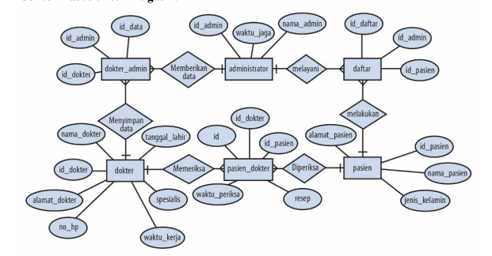

---

## JAWAB

## A. Analisis Skema dan Relasi ERD

ERD kasus rumah sakit terdiri dari enam entitas. Setiap entitas dimodelkan menjadi sebuah tabel relasional dengan kunci utama (*Primary Key*) bertipe integer auto-increment, dan keterhubungan antar entitas diwujudkan melalui kunci tamu (*Foreign Key*).

### A.1 Struktur Atribut Tabel

| Tabel | Atribut | Tipe Data | Keterangan |
| :--- | :--- | :--- | :--- |
| **administrator** | id_admin | INT(3) | Primary Key, AUTO_INCREMENT |
|  | nama_admin | VARCHAR(30) | Nama lengkap petugas administrasi |
|  | waktu_jaga | VARCHAR(100) | Jadwal shift jaga petugas |
| **dokter** | id_dokter | INT(3) | Primary Key, AUTO_INCREMENT |
|  | nama_dokter | VARCHAR(30) | Nama dokter |
|  | alamat_dokter | VARCHAR(100) | Alamat tempat tinggal dokter |
|  | tanggal_lahir | DATE | Tanggal lahir dokter |
|  | no_hp | VARCHAR(15) | Nomor telepon/kontak dokter |
|  | spesialis | VARCHAR(30) | Bidang keahlian spesialisasi |
|  | waktu_kerja | VARCHAR(100) | Jadwal hari dan jam praktik dokter |
| **pasien** | id_pasien | INT(3) | Primary Key, AUTO_INCREMENT |
|  | nama_pasien | VARCHAR(30) | Nama pasien |
|  | alamat_pasien | VARCHAR(100) | Alamat tempat tinggal pasien |
|  | jenis_kelamin | INT(1) | 1 = Laki-laki, 2 = Perempuan |
| **dokter_admin** | id_data | INT(3) | Primary Key, AUTO_INCREMENT |
|  | id_dokter | INT(3) | Foreign Key &rarr; dokter(id_dokter) |
|  | id_admin | INT(3) | Foreign Key &rarr; administrator(id_admin) |
| **daftar** | id_daftar | INT(3) | Primary Key, AUTO_INCREMENT |
|  | id_pasien | INT(3) | Foreign Key &rarr; pasien(id_pasien) |
|  | id_admin | INT(3) | Foreign Key &rarr; administrator(id_admin) |
| **pasien_dokter** | id | INT(3) | Primary Key, AUTO_INCREMENT |
|  | id_dokter | INT(3) | Foreign Key &rarr; dokter(id_dokter) |
|  | id_pasien | INT(3) | Foreign Key &rarr; pasien(id_pasien) |
|  | waktu_periksa | DATE | Tanggal pemeriksaan medis |
|  | resep | VARCHAR(100) | Catatan resep obat hasil pemeriksaan |

### A.2 Relasi Antar Tabel

| Relasi pada ERD | Tabel Induk (PK) | Tabel Anak (FK) | Kardinalitas | Aturan Referensial |
| :--- | :--- | :--- | :--- | :--- |
| Memberikan data | administrator.id_admin | dokter_admin.id_admin | One-to-Many | CASCADE |
| Menyimpan data | dokter.id_dokter | dokter_admin.id_dokter | One-to-Many | CASCADE |
| Melayani | administrator.id_admin | daftar.id_admin | One-to-Many | CASCADE |
| Melakukan | pasien.id_pasien | daftar.id_pasien | One-to-Many | CASCADE |
| Memeriksa | dokter.id_dokter | pasien_dokter.id_dokter | One-to-Many | CASCADE |
| Diperiksa | pasien.id_pasien | pasien_dokter.id_pasien | One-to-Many | CASCADE |

---

## B. Pelaksanaan Praktikum (17 Langkah Panduan Praktikum)

### Langkah 1: Akses MySQL dari Command Prompt

Untuk mengakses MySQL dari command line prompt:
- Jika menggunakan Docker:
  ```bash
  docker exec -it mysql_tugas2 mysql -u root -proot
  ```
- Jika menggunakan XAMPP di Windows:
  ```bash
  cd C:\xampp\mysql\bin
  mysql -u root -p
  ```

Setelah mengeksekusi perintah di atas, sistem menampilkan *welcome banner* MySQL Monitor dan prompt interaktif `mysql>`.

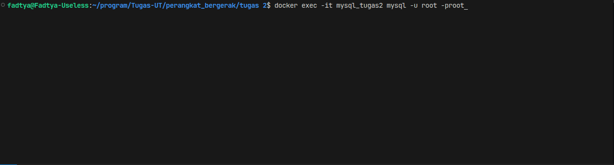

Menampilkan daftar basis data bawaan pada server:
```sql
SHOW DATABASES;
```

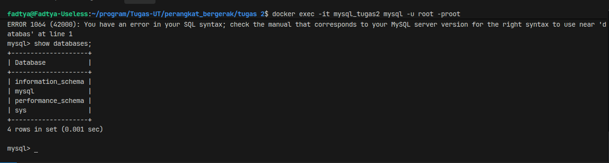

---

### Langkah 2: Akses PhpMyAdmin

Akses phpMyAdmin dilakukan melalui penjelajah web (*web browser*) dengan memasukkan URL layanan:
- Pada Docker: `http://localhost:8080`
- Pada XAMPP: `http://localhost/phpmyadmin`

Dashboard phpMyAdmin menyediakan antarmuka grafis yang memudahkan pengelolaan basis data, eksekusi query pada tab SQL, perancangan diagram relasi pada tab Designer, dan inspeksi struktur tabel.

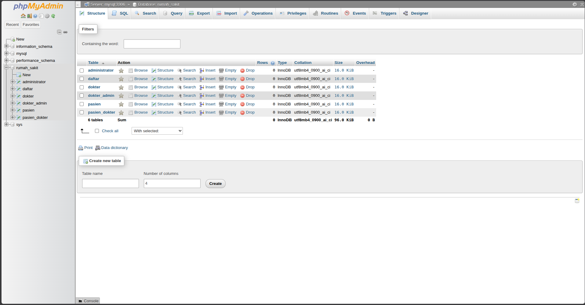

---

### Langkah 3: Pembuatan Basis Data dari Command Prompt / PhpMyAdmin

Basis data utama proyek bernama `rumah_sakit` dibuat menggunakan perintah DDL:

```sql
CREATE DATABASE IF NOT EXISTS rumah_sakit;
SHOW DATABASES;
USE rumah_sakit;
```

Basis data `rumah_sakit` berhasil dibuat dan diaktifkan untuk menerima perintah DDL pembuatan tabel berikutnya.

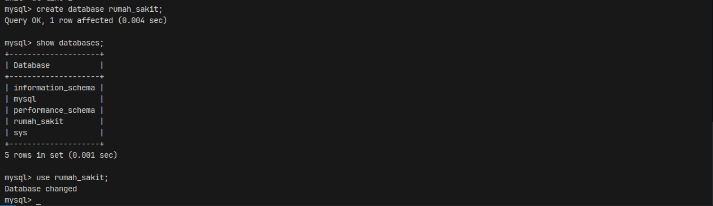

---

### Langkah 4: Drop Database

Penghapusan basis data menggunakan perintah `DROP DATABASE`. Untuk menguji perintah ini tanpa mengorbankan basis data utama, dibuat sebuah basis data pengujian sementara `db_temp_praktikum`, lalu dihapus kembali:

```sql
-- 1. Membuat database sementara untuk pengujian drop
CREATE DATABASE IF NOT EXISTS db_temp_praktikum;
SHOW DATABASES;

-- 2. Menghapus database sementara
DROP DATABASE db_temp_praktikum;

-- 3. Verifikasi bahwa database sudah terhapus
SHOW DATABASES;

-- 4. Kembali mengaktifkan database utama tugas
USE rumah_sakit;
```

Perintah `DROP DATABASE` menghapus seluruh berkas skema dan data tabel yang ada di dalam database tersebut secara permanen. Setelah eksekusi berhasil, database `db_temp_praktikum` tidak lagi muncul dalam daftar `SHOW DATABASES`.

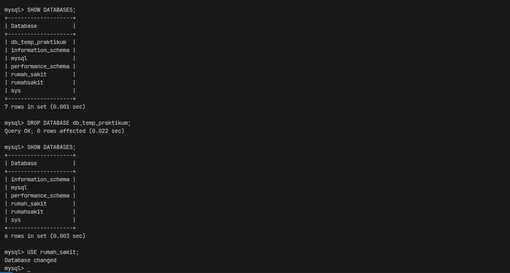

---

### Langkah 5: Pembuatan Seluruh Tabel dari ERD

Pembuatan tabel dilakukan berurutan. Tabel master (induk yang tidak memiliki foreign key) dibuat lebih dahulu, diikuti oleh tabel transaksi/relasi (tabel anak).

#### 1) Tabel `administrator`
```sql
CREATE TABLE IF NOT EXISTS administrator (
    id_admin INT(3) PRIMARY KEY AUTO_INCREMENT,
    nama_admin VARCHAR(30) NOT NULL,
    waktu_jaga VARCHAR(100) NOT NULL
) ENGINE=InnoDB;
```
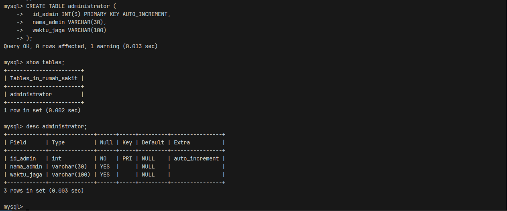

#### 2) Tabel `dokter`
```sql
CREATE TABLE IF NOT EXISTS dokter (
    id_dokter INT(3) PRIMARY KEY AUTO_INCREMENT,
    nama_dokter VARCHAR(30) NOT NULL,
    alamat_dokter VARCHAR(100) NOT NULL,
    tanggal_lahir DATE NOT NULL,
    no_hp VARCHAR(15) NOT NULL,
    spesialis VARCHAR(30) NOT NULL,
    waktu_kerja VARCHAR(100) NOT NULL
) ENGINE=InnoDB;
```
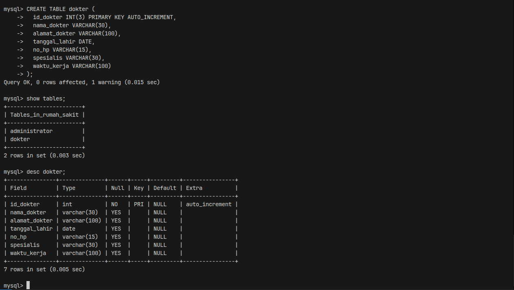

#### 3) Tabel `pasien`
```sql
CREATE TABLE IF NOT EXISTS pasien (
    id_pasien INT(3) PRIMARY KEY AUTO_INCREMENT,
    nama_pasien VARCHAR(30) NOT NULL,
    alamat_pasien VARCHAR(100) NOT NULL,
    jenis_kelamin INT(1) NOT NULL
) ENGINE=InnoDB;
```
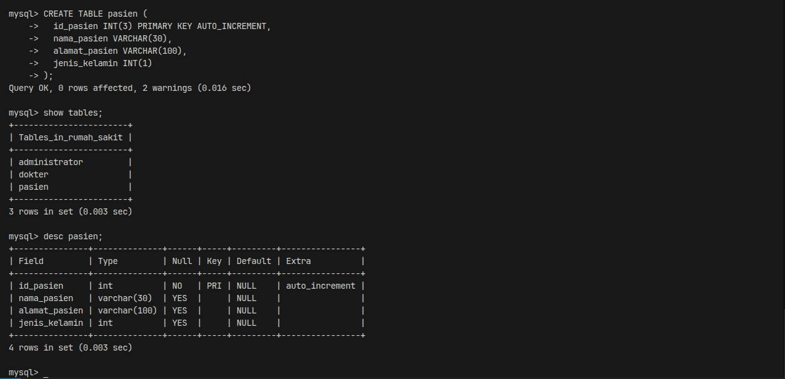

#### 4) Tabel `dokter_admin`
```sql
CREATE TABLE IF NOT EXISTS dokter_admin (
    id_data INT(3) PRIMARY KEY AUTO_INCREMENT,
    id_dokter INT(3) NOT NULL,
    id_admin INT(3) NOT NULL
) ENGINE=InnoDB;
```
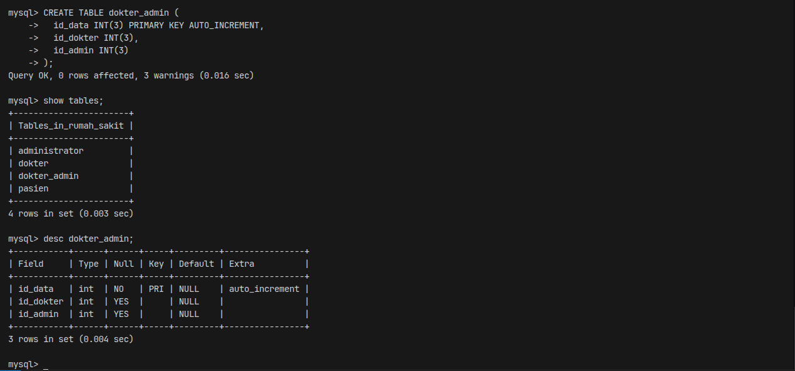

#### 5) Tabel `daftar`
```sql
CREATE TABLE IF NOT EXISTS daftar (
    id_daftar INT(3) PRIMARY KEY AUTO_INCREMENT,
    id_pasien INT(3) NOT NULL,
    id_admin INT(3) NOT NULL
) ENGINE=InnoDB;
```
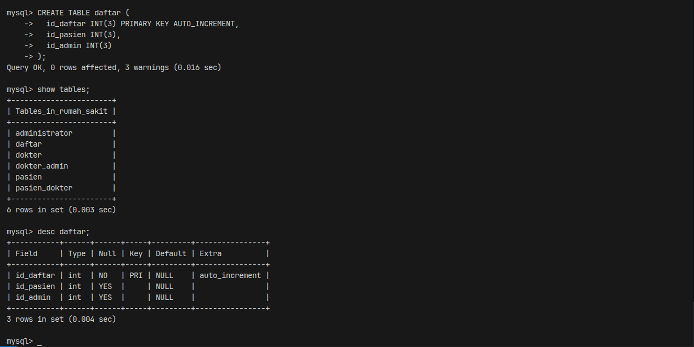

#### 6) Tabel `pasien_dokter`
```sql
CREATE TABLE IF NOT EXISTS pasien_dokter (
    id INT(3) PRIMARY KEY AUTO_INCREMENT,
    id_dokter INT(3) NOT NULL,
    id_pasien INT(3) NOT NULL,
    waktu_periksa DATE NOT NULL,
    resep VARCHAR(100) NOT NULL
) ENGINE=InnoDB;
```
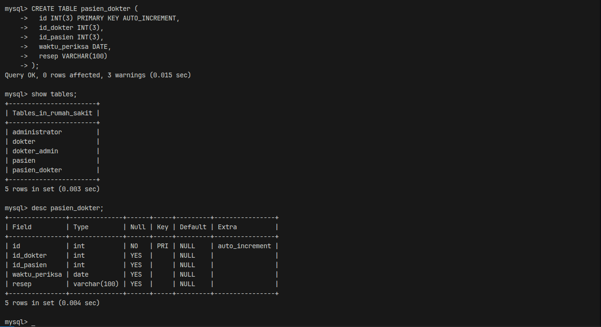

Verifikasi seluruh tabel yang telah terbentuk:
```sql
SHOW TABLES;
```
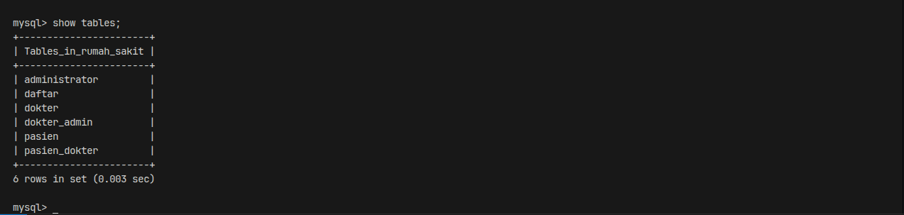

---

### Langkah 6: Setting Primary Key, Foreign Key, dan Relasi Tabel

Kunci utama (*Primary Key*) telah ditentukan langsung saat `CREATE TABLE`. Kunci tamu (*Foreign Key*) ditambahkan dengan perintah `ALTER TABLE` menggunakan opsi integritas referensial `ON DELETE CASCADE ON UPDATE CASCADE`:

```sql
-- 1. Relasi tabel dokter_admin ke dokter dan administrator
ALTER TABLE dokter_admin
    ADD CONSTRAINT fk_dokter_admin_dokter
        FOREIGN KEY (id_dokter) REFERENCES dokter(id_dokter)
        ON DELETE CASCADE ON UPDATE CASCADE,
    ADD CONSTRAINT fk_dokter_admin_admin
        FOREIGN KEY (id_admin) REFERENCES administrator(id_admin)
        ON DELETE CASCADE ON UPDATE CASCADE;

-- 2. Relasi tabel daftar ke pasien dan administrator
ALTER TABLE daftar
    ADD CONSTRAINT fk_daftar_pasien
        FOREIGN KEY (id_pasien) REFERENCES pasien(id_pasien)
        ON DELETE CASCADE ON UPDATE CASCADE,
    ADD CONSTRAINT fk_daftar_admin
        FOREIGN KEY (id_admin) REFERENCES administrator(id_admin)
        ON DELETE CASCADE ON UPDATE CASCADE;

-- 3. Relasi tabel pasien_dokter ke dokter dan pasien
ALTER TABLE pasien_dokter
    ADD CONSTRAINT fk_pasien_dokter_dokter
        FOREIGN KEY (id_dokter) REFERENCES dokter(id_dokter)
        ON DELETE CASCADE ON UPDATE CASCADE,
    ADD CONSTRAINT fk_pasien_dokter_pasien
        FOREIGN KEY (id_pasien) REFERENCES pasien(id_pasien)
        ON DELETE CASCADE ON UPDATE CASCADE;
```

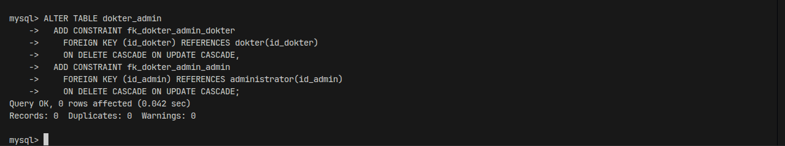

Verifikasi pendaftaran foreign key pada skema basis data:
```sql
SELECT 
    TABLE_NAME, 
    COLUMN_NAME, 
    CONSTRAINT_NAME, 
    REFERENCED_TABLE_NAME, 
    REFERENCED_COLUMN_NAME
FROM information_schema.KEY_COLUMN_USAGE
WHERE TABLE_SCHEMA = 'rumah_sakit'
  AND REFERENCED_TABLE_NAME IS NOT NULL;
```
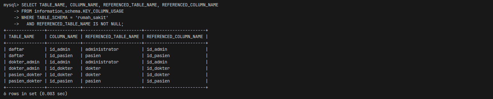

---

### Langkah 7: Penggunaan INSERT

Pengisian data contoh (*dummy data*) dilakukan secara berurutan mulai dari tabel induk (master) agar tidak terjadi pelanggaran integritas referensial (*foreign key constraint failure*):

```sql
-- 1. Insert Data Master Administrator
INSERT INTO administrator (nama_admin, waktu_jaga) VALUES
('Siti Aminah', 'Senin-Jumat 08.00-16.00'),
('Ahmad Fauzi', 'Senin-Jumat 16.00-24.00'),
('Dewi Sartika', 'Sabtu-Minggu 08.00-20.00');

-- 2. Insert Data Master Dokter
INSERT INTO dokter (nama_dokter, alamat_dokter, tanggal_lahir, no_hp, spesialis, waktu_kerja) VALUES
('Budi Harmoko', 'Jl. Melati No. 1 Jakarta', '1982-04-12', '081234567890', 'Umum', 'Senin-Rabu 09.00-14.00'),
('Indah Permata', 'Jl. Sudirman No. 45 Jakarta', '1988-09-20', '081298765432', 'Penyakit Dalam', 'Kamis-Sabtu 10.00-16.00'),
('Hendra Wijaya', 'Jl. Dahlia No. 12 Bogor', '1979-11-05', '081311223344', 'Anak', 'Senin-Jumat 08.00-12.00'),
('Siti Rahma', 'Jl. Mawar No. 7 Depok', '1990-01-15', '081377889900', 'Penyakit Dalam', 'Selasa-Kamis 13.00-18.00');

-- 3. Insert Data Master Pasien
INSERT INTO pasien (nama_pasien, alamat_pasien, jenis_kelamin) VALUES
('Andi Pratama', 'Jl. Mawar No. 5 Bekasi', 1),
('Rina Marlina', 'Jl. Anggrek No. 10 Jakarta', 2),
('Bambang Pamungkas', 'Jl. Kenanga No. 8 Tangerang', 1),
('Siti Nurhaliza', 'Jl. Melati No. 3 Jakarta', 2),
('Dedi Kurniawan', 'Jl. Cendana No. 15 Bogor', 1);

-- 4. Insert Data Transaksi / Relasi
INSERT INTO dokter_admin (id_dokter, id_admin) VALUES
(1, 1), (2, 1), (3, 2), (4, 3);

INSERT INTO daftar (id_pasien, id_admin) VALUES
(1, 1), (2, 1), (3, 2), (4, 2), (5, 3);

INSERT INTO pasien_dokter (id_dokter, id_pasien, waktu_periksa, resep) VALUES
(1, 1, '2026-10-10', 'RSP-001 Paracetamol 500mg, Amoxicillin'),
(2, 2, '2026-10-12', 'RSP-002 Omeprazole 20mg, Antasida'),
(3, 1, '2026-10-15', 'RSP-003 Vitamin C, Ibuprofen'),
(1, 3, '2026-10-18', 'RSP-004 Sirup Paracetamol, Cetirizine'),
(2, 4, '2026-10-20', 'RSP-005 Metformin 500mg'),
(4, 5, '2026-10-22', 'RSP-006 Ranitidine 150mg');
```

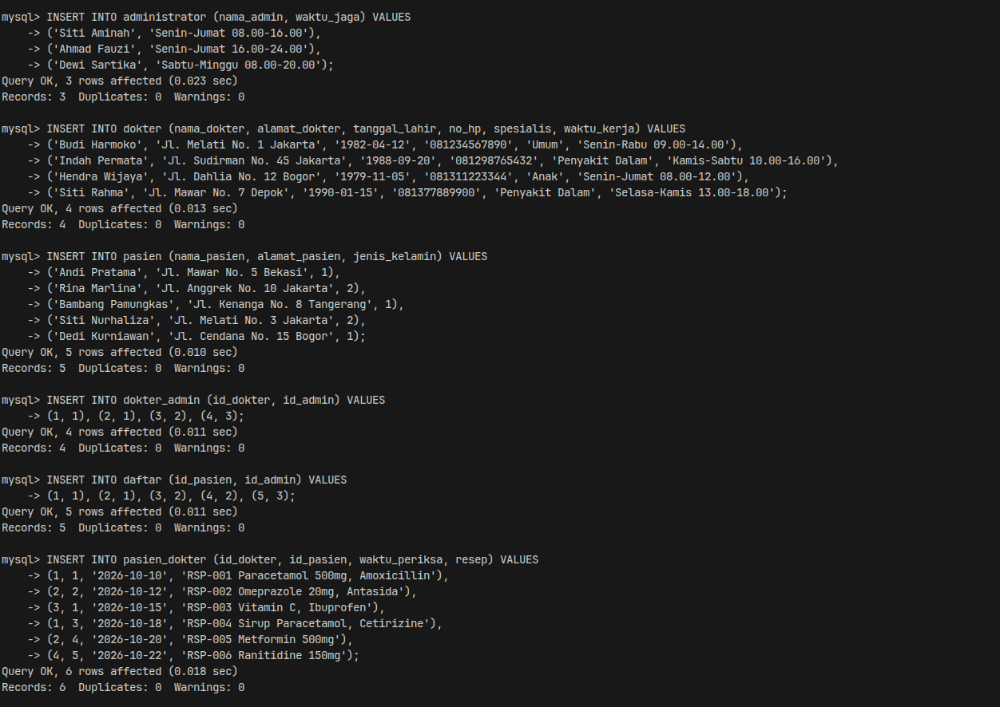

---

### Langkah 8: Penggunaan SELECT

Perintah `SELECT` digunakan untuk menampilkan rekaman data dari tabel. Praktikum ini mencakup pemilihan seluruh kolom (`*`) serta pemilihan kolom tertentu dengan alias (`AS`):

```sql
-- A. Menampilkan seluruh data tabel dokter
SELECT * FROM dokter;

-- B. Menampilkan kolom tertentu dari tabel pasien dengan alias kolom
SELECT 
    id_pasien AS 'ID Pasien', 
    nama_pasien AS 'Nama Lengkap Pasien', 
    alamat_pasien AS 'Alamat Domisili'
FROM pasien;

-- C. Menampilkan jadwal praktik dokter
SELECT 
    nama_dokter AS 'Nama Dokter', 
    spesialis AS 'Spesialisasi', 
    waktu_kerja AS 'Jadwal Praktik'
FROM dokter;
```

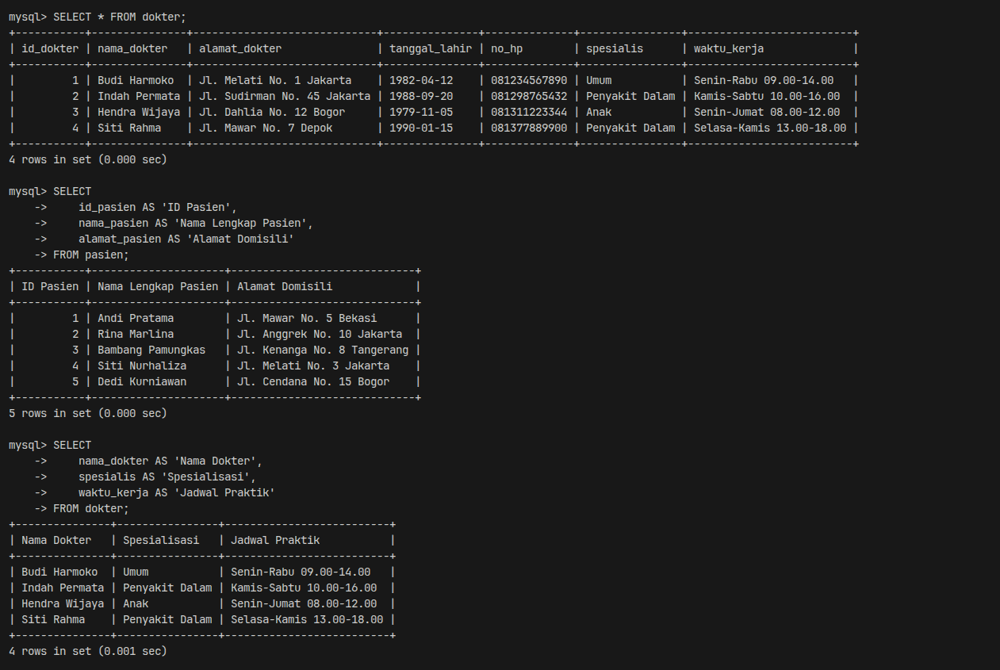

---

### Langkah 9: Penggunaan WHERE

Klausa `WHERE` membatasi baris data yang dihasilkan kueri berdasarkan kondisi logis:

```sql
-- A. Filter dokter dengan spesialisasi Penyakit Dalam
SELECT id_dokter, nama_dokter, spesialis, no_hp 
FROM dokter 
WHERE spesialis = 'Penyakit Dalam';

-- B. Filter pasien berjenis kelamin perempuan (nilai 2)
SELECT id_pasien, nama_pasien, alamat_pasien 
FROM pasien 
WHERE jenis_kelamin = 2;

-- C. Filter kondisi majemuk dengan operator AND
SELECT id, id_dokter, id_pasien, waktu_periksa, resep
FROM pasien_dokter
WHERE id_dokter = 1 AND waktu_periksa >= '2026-10-12';
```

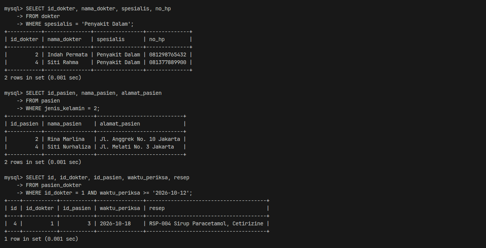

---

### Langkah 10: Penggunaan JOIN

`JOIN` menggabungkan kolom dari dua atau lebih tabel berdasarkan kolom kunci yang berelasi:

#### A. INNER JOIN 2 Tabel (`pasien`, `daftar`, dan `administrator`)
Menampilkan data pendaftaran pasien beserta administrator yang melayani:
```sql
SELECT 
    d.id_daftar,
    p.nama_pasien,
    a.nama_admin,
    a.waktu_jaga
FROM daftar d
JOIN pasien p ON d.id_pasien = p.id_pasien
JOIN administrator a ON d.id_admin = a.id_admin;
```

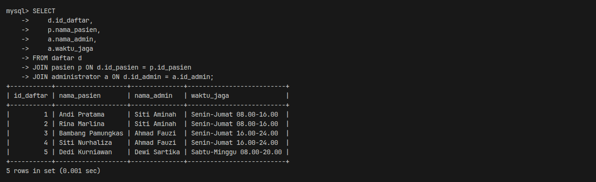

#### B. INNER JOIN 3 Tabel (`pasien`, `pasien_dokter`, dan `dokter`)
Menampilkan informasi nama pasien, waktu pemeriksaan, resep obat yang diterima, dan nama dokter yang memeriksa:
```sql
SELECT 
    pd.id AS no_pemeriksaan,
    p.nama_pasien,
    d.nama_dokter,
    d.spesialis,
    pd.waktu_periksa,
    pd.resep
FROM pasien_dokter pd
JOIN pasien p ON pd.id_pasien = p.id_pasien
JOIN dokter d ON pd.id_dokter = d.id_dokter;
```

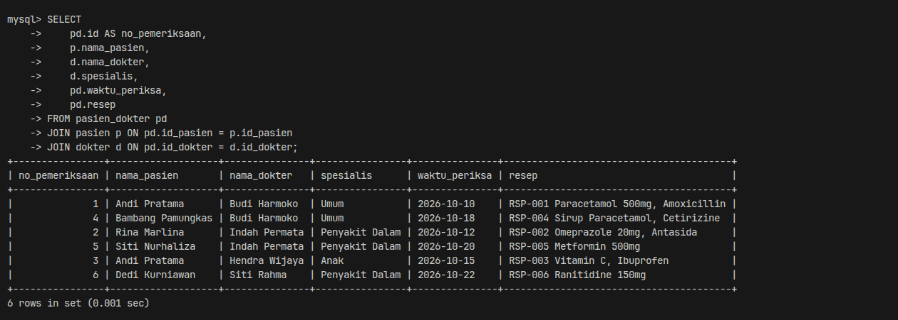

#### C. LEFT JOIN
Menampilkan seluruh dokter beserta jumlah pasien yang pernah ditangani:
```sql
SELECT 
    d.nama_dokter,
    d.spesialis,
    COUNT(pd.id) AS total_pasien_diperiksa
FROM dokter d
LEFT JOIN pasien_dokter pd ON d.id_dokter = pd.id_dokter
GROUP BY d.id_dokter, d.nama_dokter, d.spesialis;
```

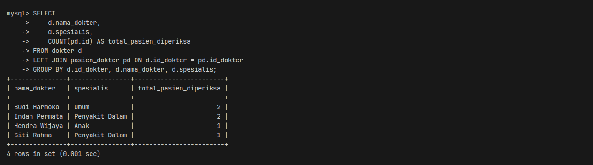

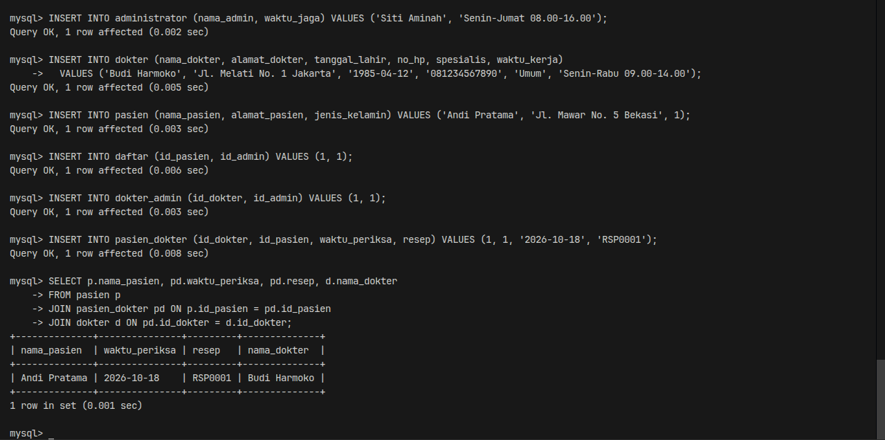

---

### Langkah 11: Penggunaan Fungsi Matematika

Fungsi matematika dan agregasi bawaan SQL digunakan untuk melakukan komputasi numerik terhadap data:

```sql
-- A. Menghitung total entitas menggunakan fungsi COUNT()
SELECT 
    (SELECT COUNT(*) FROM dokter) AS total_dokter,
    (SELECT COUNT(*) FROM pasien) AS total_pasien,
    (SELECT COUNT(*) FROM administrator) AS total_admin,
    (SELECT COUNT(*) FROM pasien_dokter) AS total_pemeriksaan;

-- B. Menghitung rata-rata usia dokter dengan TIMESTAMPDIFF, AVG, dan ROUND
SELECT 
    ROUND(AVG(TIMESTAMPDIFF(YEAR, tanggal_lahir, '2026-11-01')), 1) AS rata_rata_usia_dokter,
    MIN(tanggal_lahir) AS tgl_lahir_dokter_tertua,
    MAX(tanggal_lahir) AS tgl_lahir_dokter_termuda
FROM dokter;
```

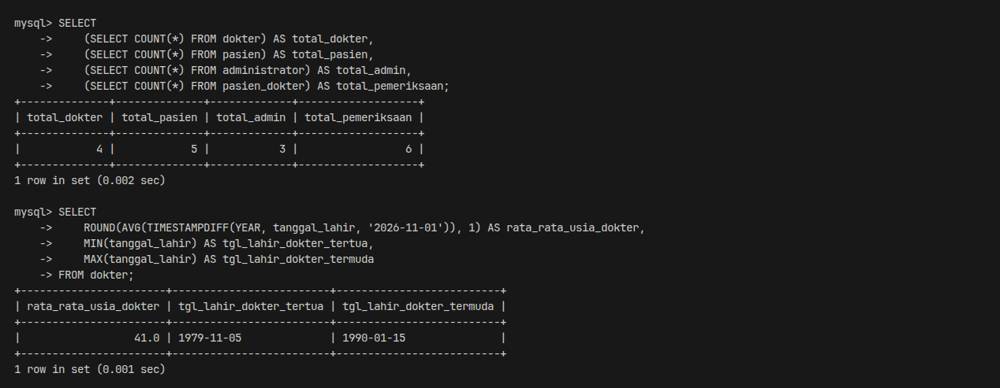

---

### Langkah 12: Penggunaan Fungsi String

Fungsi string digunakan untuk manipulasi dan pemformatan data teks:

```sql
-- A. Fungsi CONCAT: Menggabungkan gelar, nama, dan spesialisasi dokter
SELECT 
    CONCAT('dr. ', nama_dokter, ' (Spesialis ', spesialis, ')') AS profil_dokter
FROM dokter;

-- B. Fungsi UPPER dan LOWER: Standarisasi format teks kapital dan kecil
SELECT 
    UPPER(nama_pasien) AS nama_kapital,
    LOWER(alamat_pasien) AS alamat_huruf_kecil
FROM pasien;

-- C. Fungsi LENGTH dan SUBSTRING: Menghitung karakter dan mengekstrak kode resep
SELECT 
    nama_pasien,
    LENGTH(nama_pasien) AS panjang_karakter_nama
FROM pasien;

SELECT 
    id,
    resep,
    SUBSTRING(resep, 1, 7) AS kode_resep,
    SUBSTRING(resep, 9) AS rincian_obat
FROM pasien_dokter;
```

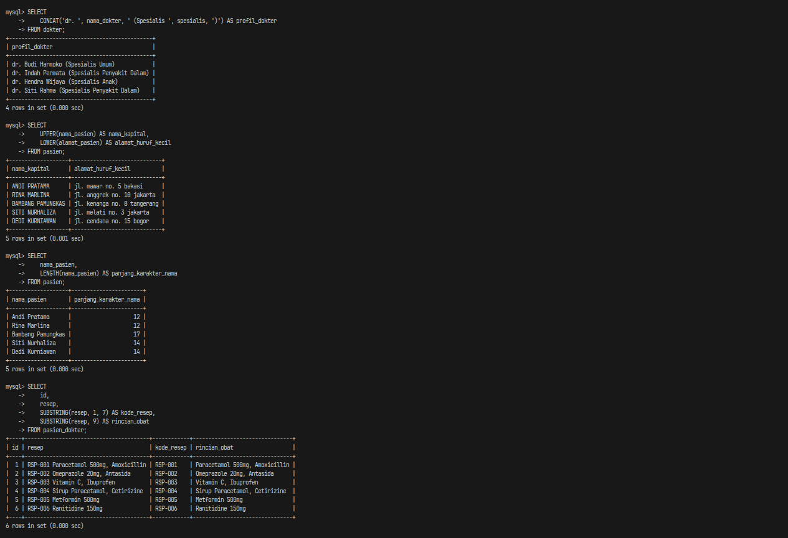

---

### Langkah 13: Penggunaan BETWEEN

Operator `BETWEEN` menyaring nilai dalam rentang inklusif (termasuk nilai batas bawah dan batas atas):

```sql
-- A. Filter dokter dengan rentang tanggal lahir pada dekade 1980-an (1980 - 1989)
SELECT nama_dokter, spesialis, tanggal_lahir 
FROM dokter 
WHERE tanggal_lahir BETWEEN '1980-01-01' AND '1989-12-31';

-- B. Filter pemeriksaan dalam rentang tanggal 10 Oktober s.d. 18 Oktober 2026
SELECT id, id_pasien, waktu_periksa, resep 
FROM pasien_dokter 
WHERE waktu_periksa BETWEEN '2026-10-10' AND '2026-10-18';

-- C. Filter ID pasien antara 2 sampai 4
SELECT id_pasien, nama_pasien, alamat_pasien 
FROM pasien 
WHERE id_pasien BETWEEN 2 AND 4;
```

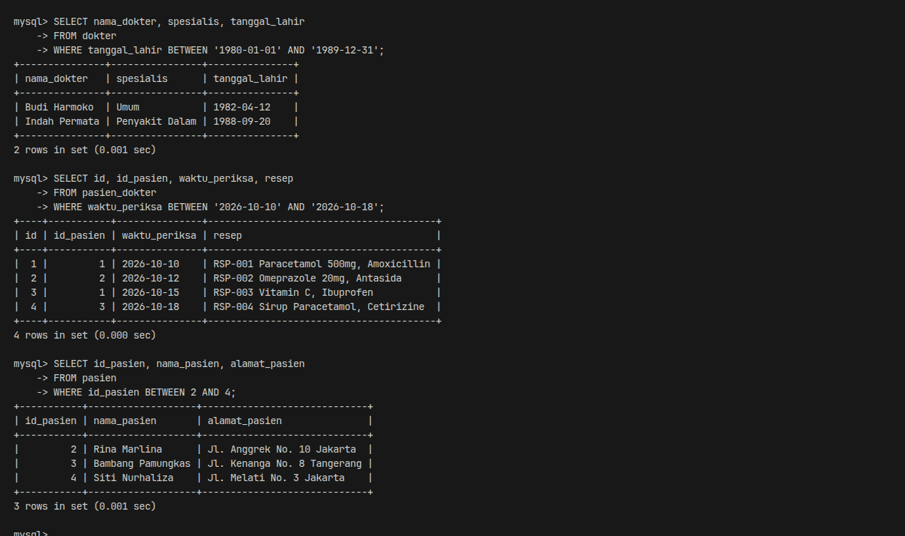

---

### Langkah 14: Penggunaan LIKE

Operator `LIKE` digunakan bersama karakter *wildcard* (`%` untuk sembarang karakter dan `_` untuk satu karakter) untuk pencocokan pola:

```sql
-- A. Wildcard awalan: Mencari pasien dengan nama berawalan huruf 'S'
SELECT id_pasien, nama_pasien, alamat_pasien 
FROM pasien 
WHERE nama_pasien LIKE 'S%';

-- B. Wildcard akhiran: Mencari dokter dengan nama berakhiran kata 'Wijaya'
SELECT id_dokter, nama_dokter, spesialis 
FROM dokter 
WHERE nama_dokter LIKE '%Wijaya';

-- C. Wildcard pola tengah: Mencari dokter dengan alamat domisili di wilayah 'Jakarta'
SELECT id_dokter, nama_dokter, alamat_dokter 
FROM dokter 
WHERE alamat_dokter LIKE '%Jakarta%';
```

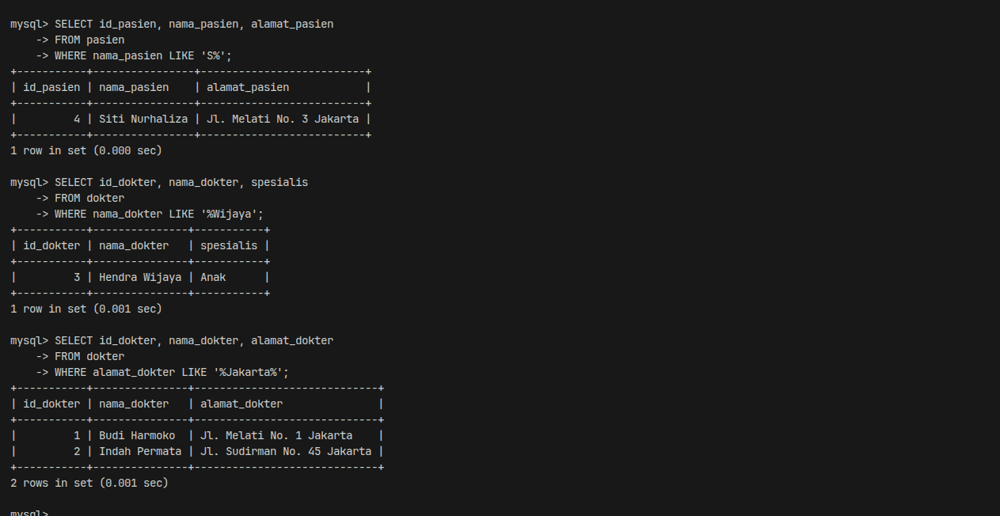

---

### Langkah 15: Penggunaan ORDER BY

Klausa `ORDER BY` mengurutkan baris data hasil kueri secara menaik (*Ascending* / `ASC`) atau menurun (*Descending* / `DESC`):

```sql
-- A. Pengurutan Ascending berdasarkan nama pasien (A ke Z)
SELECT id_pasien, nama_pasien, alamat_pasien 
FROM pasien 
ORDER BY nama_pasien ASC;

-- B. Pengurutan Descending berdasarkan tanggal lahir dokter (termuda ke tertua)
SELECT nama_dokter, tanggal_lahir, spesialis 
FROM dokter 
ORDER BY tanggal_lahir DESC;

-- C. Pengurutan multi-kolom (waktu periksa terbaru, kemudian id_dokter)
SELECT id, waktu_periksa, id_dokter, id_pasien, resep 
FROM pasien_dokter 
ORDER BY waktu_periksa DESC, id_dokter ASC;
```

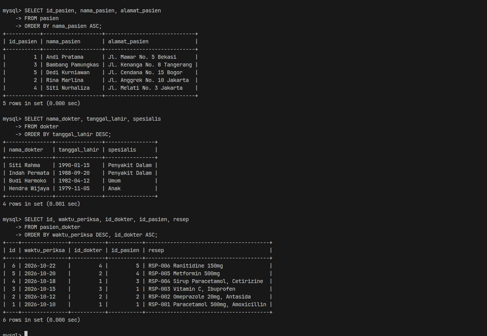

---

### Langkah 16: Penggunaan GROUP BY

Klausa `GROUP BY` mengelompokkan baris data yang memiliki nilai kolom yang sama ke dalam baris ringkasan, dipadukan dengan fungsi agregasi seperti `COUNT()`:

```sql
-- A. Menghitung jumlah pasien berdasarkan kelompok jenis kelamin
SELECT 
    CASE jenis_kelamin 
        WHEN 1 THEN 'Laki-laki' 
        WHEN 2 THEN 'Perempuan' 
    END AS kategori_jenis_kelamin,
    COUNT(*) AS jumlah_pasien
FROM pasien 
GROUP BY jenis_kelamin;

-- B. Menghitung jumlah pemeriksaan yang ditangani oleh tiap dokter
SELECT 
    d.nama_dokter, 
    d.spesialis, 
    COUNT(pd.id) AS jumlah_pemeriksaan
FROM dokter d
LEFT JOIN pasien_dokter pd ON d.id_dokter = pd.id_dokter
GROUP BY d.id_dokter, d.nama_dokter, d.spesialis;

-- C. GROUP BY dengan klausa HAVING (dokter dengan minimal 2 kali pemeriksaan)
SELECT 
    d.nama_dokter, 
    COUNT(pd.id) AS total_pemeriksaan
FROM dokter d
JOIN pasien_dokter pd ON d.id_dokter = pd.id_dokter
GROUP BY d.id_dokter, d.nama_dokter
HAVING COUNT(pd.id) >= 2;
```

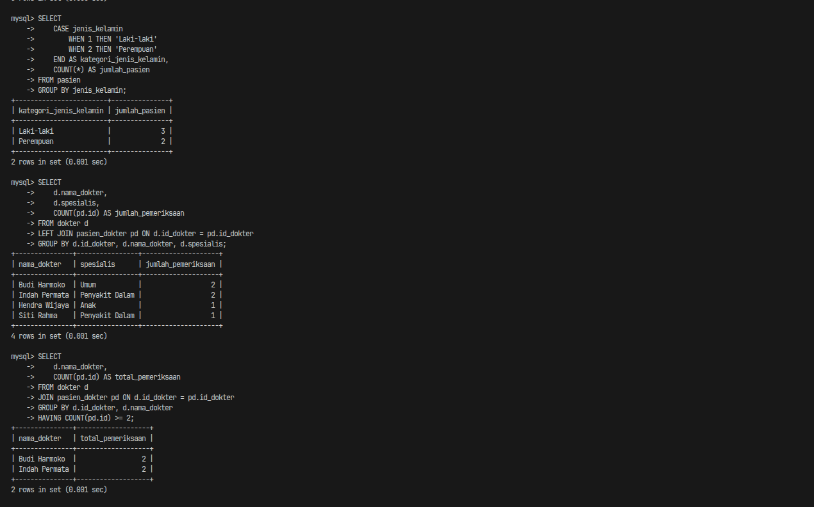

---

### Langkah 17: Penggunaan UPDATE

Perintah `UPDATE` digunakan untuk memodifikasi nilai data yang sudah tersimpan pada tabel dengan filter klausa `WHERE`:

```sql
-- A. Memperbarui nomor telepon dan jam kerja dokter spesialis (id_dokter = 1)
UPDATE dokter 
SET no_hp = '081299998888', 
    waktu_kerja = 'Senin-Jumat 08.00-15.00' 
WHERE id_dokter = 1;

-- Verifikasi perubahan dokter:
SELECT id_dokter, nama_dokter, no_hp, waktu_kerja 
FROM dokter 
WHERE id_dokter = 1;

-- B. Memperbarui data alamat domisili pasien (id_pasien = 1)
UPDATE pasien 
SET alamat_pasien = 'Jl. Boulevard Raya No. 88 Bekasi Barat' 
WHERE id_pasien = 1;

-- Verifikasi perubahan alamat pasien:
SELECT id_pasien, nama_pasien, alamat_pasien 
FROM pasien 
WHERE id_pasien = 1;

-- C. Memperbarui isi catatan resep obat pada pemeriksaan (id = 1)
UPDATE pasien_dokter 
SET resep = 'RSP-001 Paracetamol 500mg, Amoxicillin 500mg, Vitamin B Complex' 
WHERE id = 1;

-- Verifikasi perubahan resep:
SELECT id, id_pasien, waktu_periksa, resep 
FROM pasien_dokter 
WHERE id = 1;
```

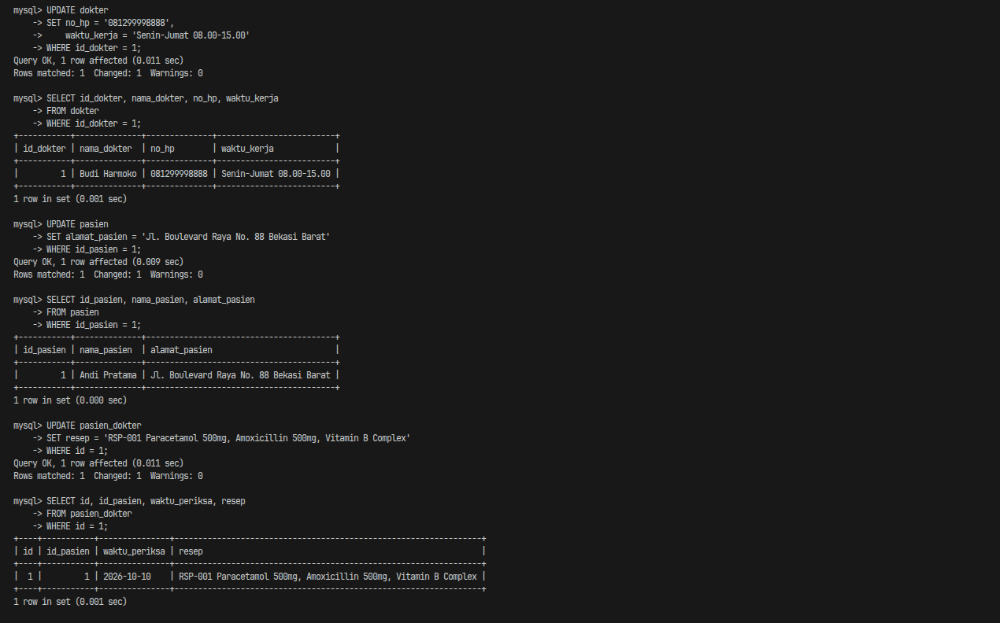

Hasil verifikasi melalui `SELECT` membuktikan bahwa pembaruan data berhasil disimpan ke dalam basis data tanpa menimbulkan inkonsistensi.

---

## C. Hasil Akhir Praktikum

Seluruh 17 langkah panduan praktikum telah berhasil dilaksanakan dengan hasil yang terverifikasi:

| No | Langkah Praktikum | Perintah Utama | Objek Sasaran | Status |
| :---: | :--- | :--- | :--- | :---: |
| 1 | Akses MySQL CLI | `docker exec -it ... mysql` | Server MySQL | **BERHASIL** |
| 2 | Akses phpMyAdmin | Browser `localhost:8080` | Web UI | **BERHASIL** |
| 3 | Pembuatan Basis Data | `CREATE DATABASE` | `rumah_sakit` | **BERHASIL** |
| 4 | Drop Database | `DROP DATABASE` | `db_temp_praktikum` | **BERHASIL** |
| 5 | Pembuatan 6 Tabel ERD | `CREATE TABLE` | Master & Transaksi | **BERHASIL** |
| 6 | Pengaturan PK, FK, & Relasi | `ALTER TABLE ... ADD CONSTRAINT` | 6 Relasi Relasional | **BERHASIL** |
| 7 | Penggunaan INSERT | `INSERT INTO ... VALUES` | Seluruh Tabel | **BERHASIL** |
| 8 | Penggunaan SELECT | `SELECT *`, Proyeksi Kolom | `dokter`, `pasien` | **BERHASIL** |
| 9 | Penggunaan WHERE | `WHERE` dengan Operator `AND` | Filter Data Spesifik | **BERHASIL** |
| 10 | Penggunaan JOIN | `INNER JOIN`, `LEFT JOIN` | 2 & 3 Tabel | **BERHASIL** |
| 11 | Fungsi Matematika | `COUNT`, `AVG`, `ROUND`, `MIN`, `MAX` | Komputasi Numerik | **BERHASIL** |
| 12 | Fungsi String | `CONCAT`, `UPPER`, `LOWER`, `SUBSTRING` | Format Teks | **BERHASIL** |
| 13 | Operator BETWEEN | `WHERE ... BETWEEN ... AND` | Filter Rentang Nilai | **BERHASIL** |
| 14 | Operator LIKE | `LIKE 'S%'`, `'%Wijaya'`, `'%Jakarta%'` | Pencocokan Pola | **BERHASIL** |
| 15 | Pengurutan ORDER BY | `ORDER BY ... ASC / DESC` | Urutan Huruf & Waktu | **BERHASIL** |
| 16 | Pengelompokan GROUP BY | `GROUP BY`, `HAVING` | Agregasi Kelompok | **BERHASIL** |
| 17 | Pembaruan UPDATE | `UPDATE ... SET ... WHERE` | Master & Transaksi | **BERHASIL** |

Tampilan relasi keseluruhan enam tabel pada menu **Designer** phpMyAdmin membuktikan bahwa seluruh relasi referensial telah terhubung secara utuh:

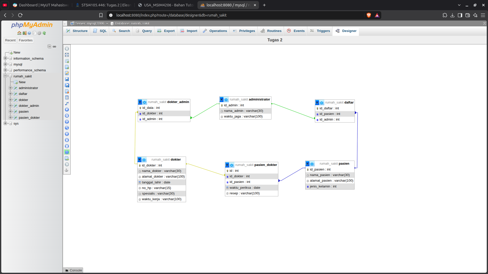

---

## D. Kesimpulan

1. **Rancangan Relasional:** ERD kasus rumah sakit telah berhasil diwujudkan ke dalam skema fisik basis data relasional MySQL/MariaDB dengan struktur normalisasi yang baik, terdiri dari tiga tabel master (`administrator`, `dokter`, `pasien`) dan tiga tabel relasi/transaksi (`dokter_admin`, `daftar`, `pasien_dokter`).
2. **Integritas Referensial:** Penggunaan *foreign key constraints* dengan klausul `ON DELETE CASCADE ON UPDATE CASCADE` menjamin tidak terjadinya *orphan records* dan menjaga konsistensi data antar tabel relasional.
3. **Kepatuhan Praktikum:** Seluruh 17 langkah instruksi praktikum modul basis data telah dilaksanakan secara lengkap, mulai dari manajemen DDL (create/drop database dan tabel), DML (insert dan update), hingga eksplorasi kueri analitik DQL (select, filtering, joins, mathematical & string functions, range, pattern matching, ordering, dan grouping).
4. **Validasi Visual:** Integritas relasi tabel telah tervalidasi baik melalui kueri SQL di terminal CLI maupun melalui diagram relasi visual pada antarmuka *Designer* phpMyAdmin.

---

## Referensi

1. Modul Praktikum MSIM4206 – Basis Data, Universitas Terbuka.
2. MySQL 8.0 Reference Manual: *Data Definition Statements, Data Manipulation Statements, and Optimization*. Oracle Corporation.
3. Silberschatz, A., Korth, H. F., & Sudarshan, S. (2020). *Database System Concepts* (7th ed.). McGraw-Hill.
