# TUGAS 2 – BASIS DATA (MSIM4206)

**Implementasi ERD Rumah Sakit ke Basis Data MySQL/MariaDB pada XAMPP**

|  |  |  |
| --- | --- | --- |
| **Nama** | : | Farhan Aditya |
| **NIM** | : | 054750333 |
| **Prodi** | : | Sistem Informasi |

## SOAL

Berdasarkan Entity Relationship Diagram (ERD) kasus rumah sakit, buatlah basis data MySQL/MariaDB pada XAMPP dengan tabel **dokter, pasien, administrator, pasien_dokter, daftar, dan dokter_admin**, lengkap dengan rincian atribut yang sesuai. Kegiatan praktik dilaporkan dalam rekaman video yang memuat: (a) perkenalan identitas mahasiswa, (b) langkah-langkah praktik beserta aktivitas mahasiswa, (c) hasil praktik, dan (d) kata penutup.

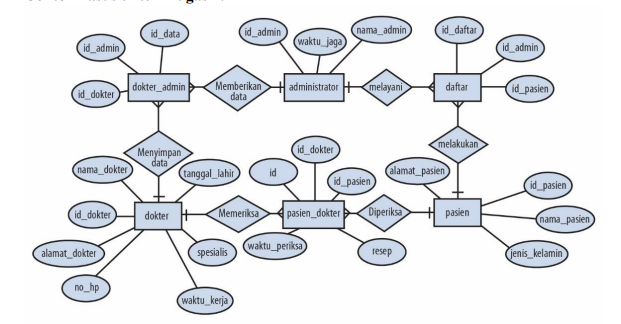

## JAWAB

## A. Langkah-Langkah Praktik

### A.1 Analisis ERD

ERD pada soal terdiri dari enam entitas. Setiap entitas dibuat menjadi satu tabel, dan relasi antar entitas diwujudkan dengan *foreign key*.

| Tabel | Atribut | Tipe Data | Keterangan |
| --- | --- | --- | --- |
| administrator | id_admin | INT(3) | Primary Key, AUTO_INCREMENT |
|  | nama_admin | VARCHAR(30) |  |
|  | waktu_jaga | VARCHAR(100) |  |
| dokter | id_dokter | INT(3) | Primary Key, AUTO_INCREMENT |
|  | nama_dokter | VARCHAR(30) |  |
|  | alamat_dokter | VARCHAR(100) |  |
|  | tanggal_lahir | DATE |  |
|  | no_hp | VARCHAR(15) |  |
|  | spesialis | VARCHAR(30) |  |
|  | waktu_kerja | VARCHAR(100) |  |
| pasien | id_pasien | INT(3) | Primary Key, AUTO_INCREMENT |
|  | nama_pasien | VARCHAR(30) |  |
|  | alamat_pasien | VARCHAR(100) |  |
|  | jenis_kelamin | INT(1) | 1 = laki-laki, 2 = perempuan |
| dokter_admin | id_data | INT(3) | Primary Key, AUTO_INCREMENT |
|  | id_dokter | INT(3) | Foreign Key → dokter.id_dokter |
|  | id_admin | INT(3) | Foreign Key → administrator.id_admin |
| pasien_dokter | id | INT(3) | Primary Key, AUTO_INCREMENT |
|  | id_dokter | INT(3) | Foreign Key → dokter.id_dokter |
|  | id_pasien | INT(3) | Foreign Key → pasien.id_pasien |
|  | waktu_periksa | DATE |  |
|  | resep | VARCHAR(100) |  |
| daftar | id_daftar | INT(3) | Primary Key, AUTO_INCREMENT |
|  | id_pasien | INT(3) | Foreign Key → pasien.id_pasien |
|  | id_admin | INT(3) | Foreign Key → administrator.id_admin |

Relasi yang dibentuk (semua *one-to-many*):

| Relasi pada ERD | Tabel Induk (PK) | Tabel Anak (FK) |
| --- | --- | --- |
| Memberikan data | administrator.id_admin | dokter_admin.id_admin |
| Menyimpan data | dokter.id_dokter | dokter_admin.id_dokter |
| Melayani | administrator.id_admin | daftar.id_admin |
| Melakukan | pasien.id_pasien | daftar.id_pasien |
| Memeriksa | dokter.id_dokter | pasien_dokter.id_dokter |
| Diperiksa | pasien.id_pasien | pasien_dokter.id_pasien |

### A.2 Menjalankan Layanan Basis Data

Jalankan modul Apache dan MySQL/MariaDB pada XAMPP Control Panel (atau menggunakan container Docker). Pastikan status service telah aktif dan siap menerima koneksi.

### A.3 Masuk ke MySQL/MariaDB Monitor

Buka terminal / Command Prompt, lalu masuk ke MySQL monitor sebagai user root:

```bash
docker exec -it mysql_tugas2 mysql -u root -proot
```
*(Atau via CMD XAMPP: `cd c:\xampp\mysql\bin` lalu jalankan `mysql -u root`)*

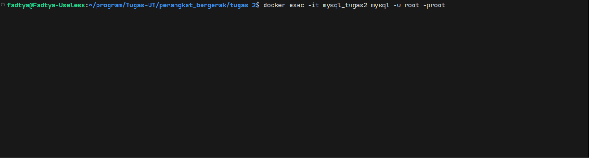

Tampilkan daftar basis data yang tersedia saat ini:

```sql
SHOW DATABASES;
```

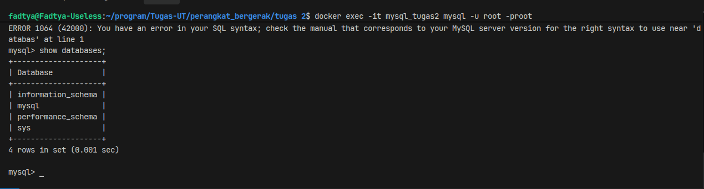

### A.4 Membuat Basis Data `rumah_sakit` (DDL)

Buat basis data baru bernama `rumah_sakit`, lalu verifikasi dan aktifkan untuk digunakan:

```sql
CREATE DATABASE rumah_sakit;
SHOW DATABASES;
USE rumah_sakit;
```

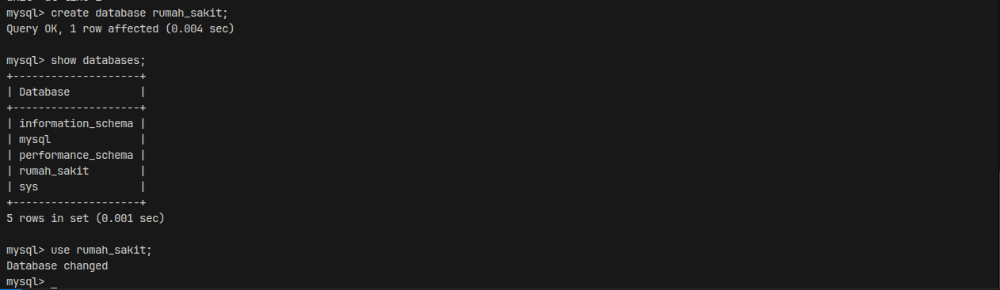

### A.5 Membuat Tabel (DDL)

Tabel yang tidak memiliki *foreign key* dibuat lebih dulu, yaitu `administrator`, `dokter`, dan `pasien`. Setelah itu dibuat tabel anak yaitu `dokter_admin`, `pasien_dokter`, dan `daftar`.

**1) Tabel administrator**

```sql
CREATE TABLE administrator (
  id_admin INT(3) PRIMARY KEY AUTO_INCREMENT,
  nama_admin VARCHAR(30),
  waktu_jaga VARCHAR(100)
);
```

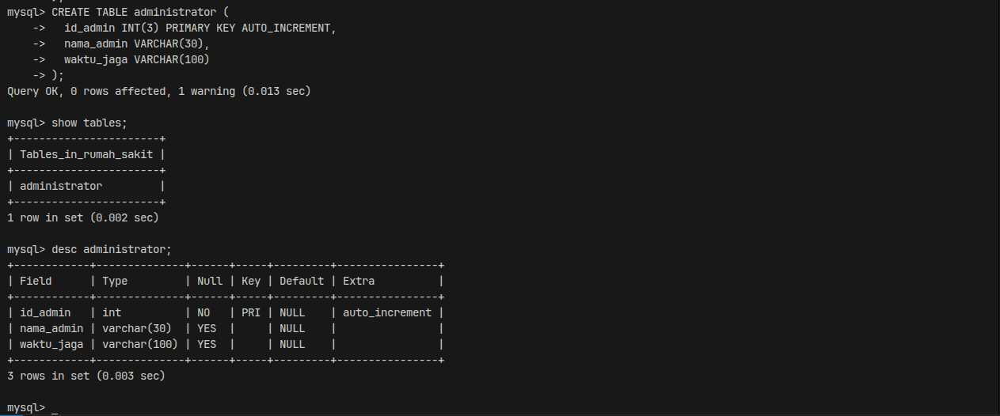

**2) Tabel dokter**

```sql
CREATE TABLE dokter (
  id_dokter INT(3) PRIMARY KEY AUTO_INCREMENT,
  nama_dokter VARCHAR(30),
  alamat_dokter VARCHAR(100),
  tanggal_lahir DATE,
  no_hp VARCHAR(15),
  spesialis VARCHAR(30),
  waktu_kerja VARCHAR(100)
);
```

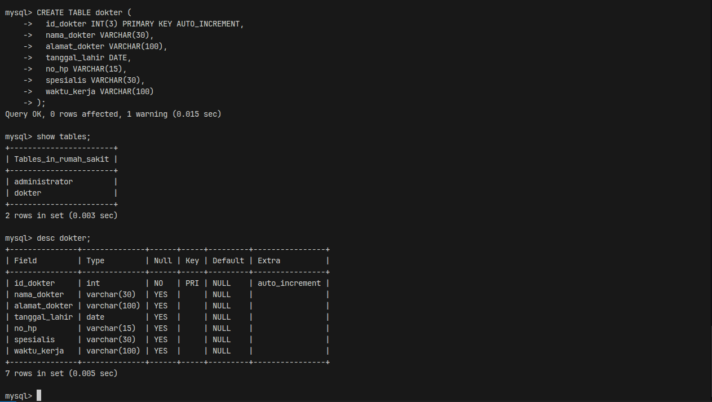

**3) Tabel pasien**

```sql
CREATE TABLE pasien (
  id_pasien INT(3) PRIMARY KEY AUTO_INCREMENT,
  nama_pasien VARCHAR(30),
  alamat_pasien VARCHAR(100),
  jenis_kelamin INT(1)
);
```

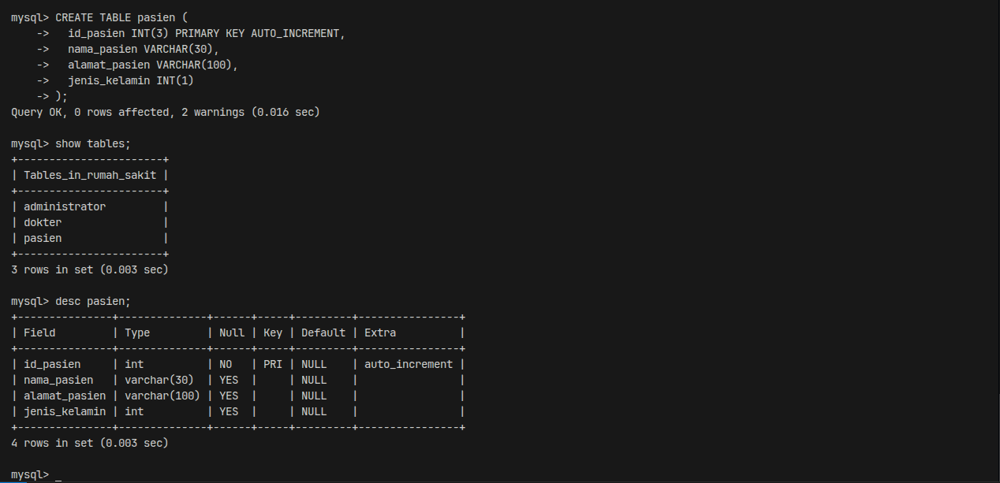

**4) Tabel dokter_admin**

```sql
CREATE TABLE dokter_admin (
  id_data INT(3) PRIMARY KEY AUTO_INCREMENT,
  id_dokter INT(3),
  id_admin INT(3)
);
```

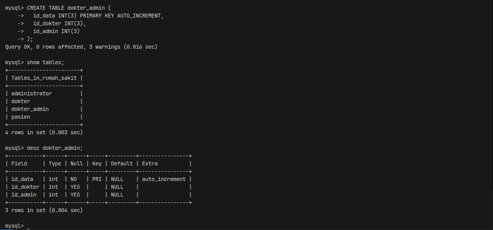

**5) Tabel pasien_dokter**

```sql
CREATE TABLE pasien_dokter (
  id INT(3) PRIMARY KEY AUTO_INCREMENT,
  id_dokter INT(3),
  id_pasien INT(3),
  waktu_periksa DATE,
  resep VARCHAR(100)
);
```

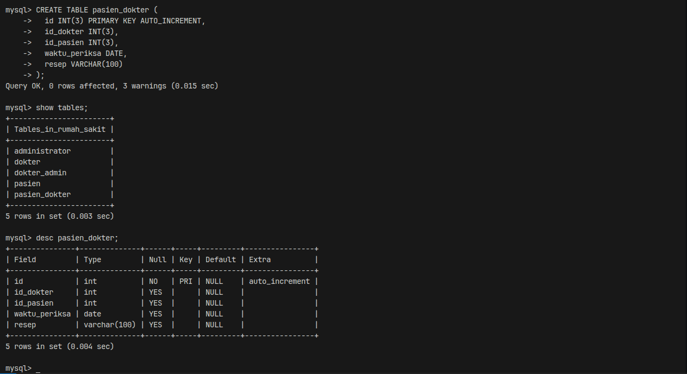

**6) Tabel daftar**

```sql
CREATE TABLE daftar (
  id_daftar INT(3) PRIMARY KEY AUTO_INCREMENT,
  id_pasien INT(3),
  id_admin INT(3)
);
```

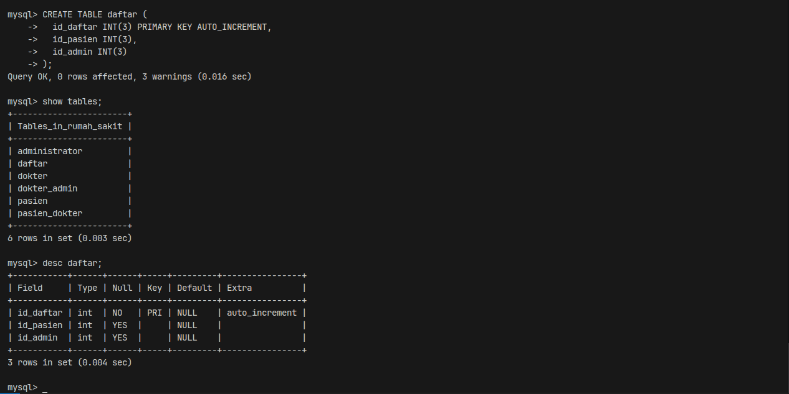

Periksa seluruh tabel yang sudah selesai dibuat:

```sql
SHOW TABLES;
DESC pasien;
```

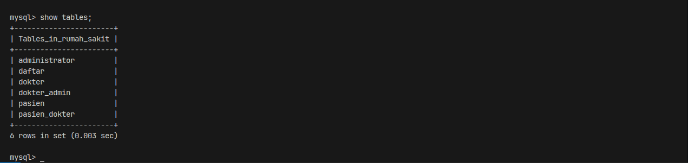

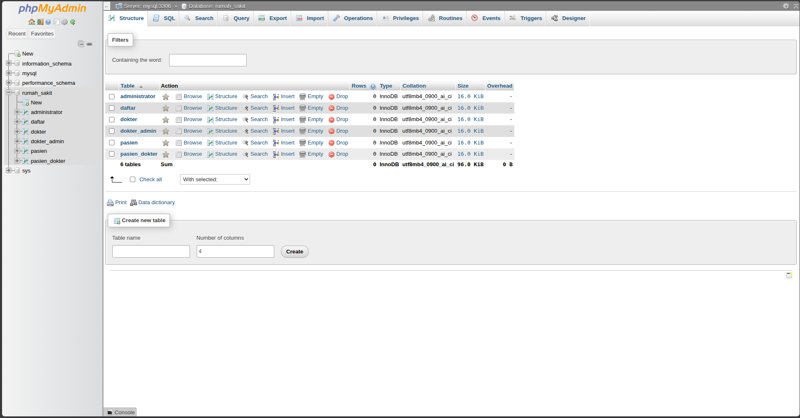

### A.6 Membuat Relasi Antar Tabel (Foreign Key)

Relasi dapat dibuat lewat menu **Designer** phpMyAdmin atau lewat perintah SQL DDL. Pada praktik ini disediakan kedua cara.

**Cara 1 – Perintah SQL DDL (Terminal atau Menu SQL phpMyAdmin)**

1. Relasi tabel `dokter_admin` (menghubungkan ke `dokter` dan `administrator`):
```sql
ALTER TABLE dokter_admin
  ADD CONSTRAINT fk_dokter_admin_dokter
    FOREIGN KEY (id_dokter) REFERENCES dokter(id_dokter)
    ON DELETE CASCADE ON UPDATE CASCADE,
  ADD CONSTRAINT fk_dokter_admin_admin
    FOREIGN KEY (id_admin) REFERENCES administrator(id_admin)
    ON DELETE CASCADE ON UPDATE CASCADE;
```

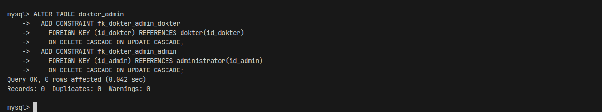

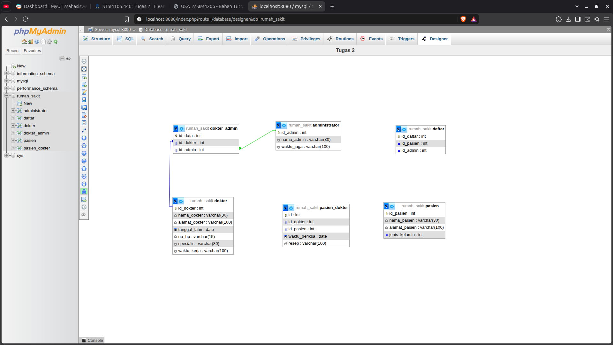

2. Relasi tabel `daftar` (menghubungkan ke `pasien` dan `administrator`):
```sql
ALTER TABLE daftar
  ADD CONSTRAINT fk_daftar_pasien
    FOREIGN KEY (id_pasien) REFERENCES pasien(id_pasien)
    ON DELETE CASCADE ON UPDATE CASCADE,
  ADD CONSTRAINT fk_daftar_admin
    FOREIGN KEY (id_admin) REFERENCES administrator(id_admin)
    ON DELETE CASCADE ON UPDATE CASCADE;
```

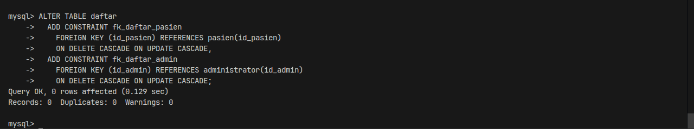

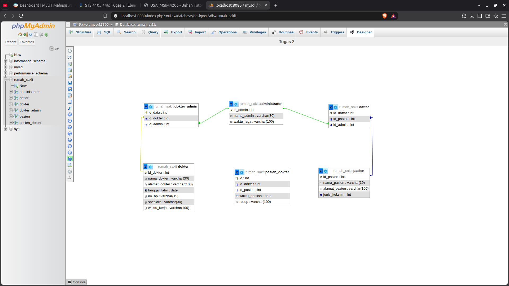

3. Relasi tabel `pasien_dokter` (menghubungkan ke `dokter` dan `pasien`):
```sql
ALTER TABLE pasien_dokter
  ADD CONSTRAINT fk_pasien_dokter_dokter
    FOREIGN KEY (id_dokter) REFERENCES dokter(id_dokter)
    ON DELETE CASCADE ON UPDATE CASCADE,
  ADD CONSTRAINT fk_pasien_dokter_pasien
    FOREIGN KEY (id_pasien) REFERENCES pasien(id_pasien)
    ON DELETE CASCADE ON UPDATE CASCADE;
```

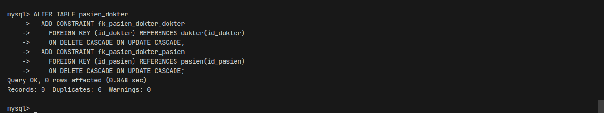

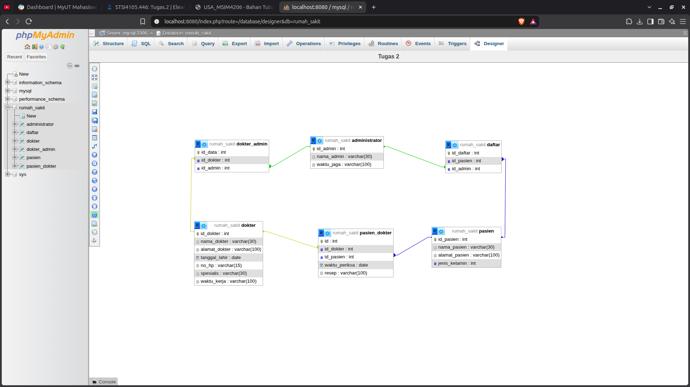

`ON DELETE CASCADE` dan `ON UPDATE CASCADE` dipilih agar data pada tabel anak ikut terhapus atau berubah ketika data pada tabel induk dihapus atau diubah, sehingga integritas referensial data tetap konsisten.

**Cara 2 – Designer phpMyAdmin**

1. Buka browser menuju phpMyAdmin (`http://localhost/phpmyadmin` atau `http://localhost:8080`), pilih basis data **rumah_sakit**.
2. Pada tabel `dokter_admin`, `daftar`, dan `pasien_dokter`, pastikan kolom yang akan menjadi foreign key sudah memiliki index (menu **Structure** → **Index**).
3. Buka tab **Designer**, lalu posisikan letak tabel agar rapi dan mudah dibaca.
4. Klik tombol **Create relationship**, klik kolom primary key pada tabel induk sebagai *referenced key*, lalu klik kolom foreign key pada tabel anak.
5. Pada kotak dialog *Create relationship FOREIGN KEY*, atur opsi **CASCADE** pada *on delete* dan *on update*, kemudian klik **OK**.
6. Ulangi langkah di atas hingga keenam relasi terbentuk, lalu klik **Save page**.

### A.7 Verifikasi Relasi

Jalankan query ke `information_schema` untuk memeriksa apakah seluruh foreign key sudah terdaftar aktif:

```sql
SELECT TABLE_NAME, COLUMN_NAME, REFERENCED_TABLE_NAME, REFERENCED_COLUMN_NAME
FROM information_schema.KEY_COLUMN_USAGE
WHERE TABLE_SCHEMA = 'rumah_sakit'
  AND REFERENCED_TABLE_NAME IS NOT NULL;
```

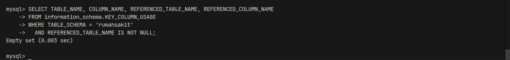

### A.8 Uji Relasi dengan Data Contoh (Opsional)

Data contoh dimasukkan untuk menguji integritas dan fungsi relasi antar tabel. Urutan pengisian dimulai dari tabel induk (master), baru kemudian tabel anak:

```sql
INSERT INTO administrator (nama_admin, waktu_jaga) VALUES ('Siti Aminah', 'Senin-Jumat 08.00-16.00');
INSERT INTO dokter (nama_dokter, alamat_dokter, tanggal_lahir, no_hp, spesialis, waktu_kerja)
  VALUES ('Budi Harmoko', 'Jl. Melati No. 1 Jakarta', '1985-04-12', '081234567890', 'Umum', 'Senin-Rabu 09.00-14.00');
INSERT INTO pasien (nama_pasien, alamat_pasien, jenis_kelamin) VALUES ('Andi Pratama', 'Jl. Mawar No. 5 Bekasi', 1);
INSERT INTO daftar (id_pasien, id_admin) VALUES (1, 1);
INSERT INTO dokter_admin (id_dokter, id_admin) VALUES (1, 1);
INSERT INTO pasien_dokter (id_dokter, id_pasien, waktu_periksa, resep) VALUES (1, 1, '2026-10-18', 'RSP0001');

SELECT p.nama_pasien, pd.waktu_periksa, pd.resep, d.nama_dokter
FROM pasien p
JOIN pasien_dokter pd ON p.id_pasien = pd.id_pasien
JOIN dokter d ON pd.id_dokter = d.id_dokter;
```

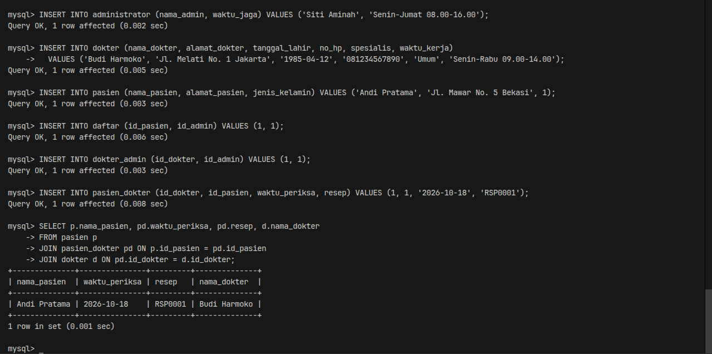

## B. Hasil Praktik

Hasil akhir dari praktikum ini adalah basis data **rumah_sakit** yang memuat enam tabel sesuai ERD rumah sakit, dilengkapi kunci utama (primary key) dan enam relasi foreign key yang saling terhubung secara utuh:

| No | Tabel | Primary Key | Foreign Key |
| --- | --- | --- | --- |
| 1 | administrator | id_admin | – |
| 2 | dokter | id_dokter | – |
| 3 | pasien | id_pasien | – |
| 4 | dokter_admin | id_data | id_dokter, id_admin |
| 5 | pasien_dokter | id | id_dokter, id_pasien |
| 6 | daftar | id_daftar | id_pasien, id_admin |


Struktur tabel dan relasi pada basis data telah terverifikasi sesuai dengan spesifikasi ERD kasus rumah sakit pada soal tugas.

## Referensi

1. Universitas Terbuka. *Basis Data* (MSIM4206), BMP, bagian Data Definition Language (DDL) dan Data Manipulation Language (DML).
2. Suryadi, A. *Panduan Praktikum SQL* (STSI4105), Edisi 2. Universitas Terbuka, Bab 2 (Prosedur Pelaksanaan Praktik).
