# TUGAS 3 – BASIS DATA (MSIM4206)

**Praktikum Transaksi dan Basis Data Terdistribusi (Replikasi Master–Slave)**

|  |  |  |
| --- | --- | --- |
| **Nama** | : | Farhan Aditya |
| **NIM** | : | 054750333 |
| **Prodi** | : | Sistem Informasi |

---

## SOAL

Berdasarkan Panduan Praktikum Mata Kuliah MSIM4206 Basis Data Edisi 2 dan instruksi Tugas 3:
1. **Praktikum Transaksi:** Lakukan evaluasi *storage engine* InnoDB pada basis data rumah sakit, uji coba kontrol transaksi (`COMMIT`, `ROLLBACK`, `SAVEPOINT`), penambahan tabel `obat` dan `transaksi_obat`, serta pembuatan dan pengujian *trigger* pengurangan stok otomatis.
2. **Praktikum Basis Data Terdistribusi:** Lakukan konfigurasi replikasi basis data Master–Slave (multi-node), verifikasi status aktif replikasi (`Slave_IO_Running` dan `Slave_SQL_Running`), serta uji sinkronisasi data secara *real-time*.

Kegiatan praktik dilaporkan dalam naskah laporan formal dan rekaman video yang memuat: (a) perkenalan identitas mahasiswa, (b) langkah-langkah praktik beserta aktivitas mahasiswa, (c) hasil praktik, dan (d) kata penutup.


---

## JAWAB

## A. Langkah-Langkah Praktik

### A.1 Analisis Kebutuhan Basis Data & Keterkaitan Tugas 2

Praktikum Tugas 3 merupakan kelanjutan langsung dari basis data **`rumah_sakit`** yang telah dirancang pada Tugas 2. Pada tugas sebelumnya, telah dibuat 6 tabel utama: `administrator`, `dokter`, `pasien`, `dokter_admin`, `pasien_dokter`, dan `daftar`. 

Pada Tugas 3 ini, basis data dikembangkan lebih lanjut dengan menambahkan:
1. **Tabel Katalog Obat (`obat`):** Menyimpan daftar obat beserta persediaan (*stok*).
2. **Tabel Penjualan/Transaksi Obat (`transaksi_obat`):** Mencatat transaksi pembelian obat oleh pasien, yang berelasi dengan tabel `pasien` dan `obat`.
3. **Event Trigger (`tg_jual`):** Menjamin integritas data persediaan dengan memicu pengurangan kuantitas stok pada tabel `obat` setiap kali transaksi baru dicatat pada tabel `transaksi_obat`.
4. **Arsitektur Terdistribusi (Replikasi):** Menghubungkan server basis data Master (port 3306) ke server basis data Slave (port 3307) agar seluruh perubahan data tersinkronisasi secara otomatis.

Rincian atribut 2 tabel baru pada Tugas 3:

| Tabel | Atribut | Tipe Data | Keterangan |
| --- | --- | --- | --- |
| **obat** | `id_obat` | INT(6) | Primary Key, `AUTO_INCREMENT` |
|  | `kode_obat` | VARCHAR(5) | Kode katalog unik obat |
|  | `nama_obat` | VARCHAR(30) | Nama komersial/generik obat |
|  | `harga` | INT(10) | Harga satuan obat (Rupiah) |
|  | `stok` | INT(5) | Jumlah persediaan fisik obat |
| **transaksi_obat** | `id_transaksi` | INT(3) | Primary Key, `AUTO_INCREMENT` |
|  | `id_pasien` | INT(3) | Foreign Key → `pasien.id_pasien` |
|  | `id_obat` | INT(3) | Foreign Key → `obat.id_obat` |
|  | `jumlah` | INT(10) | Jumlah kuantitas obat yang dibeli |
|  | `total_harga` | INT(10) | Total biaya transaksi |

Relasi Foreign Key yang dibentuk:
- `transaksi_obat.id_pasien` mereferensikan `pasien.id_pasien` (`ON DELETE CASCADE ON UPDATE CASCADE`)
- `transaksi_obat.id_obat` mereferensikan `obat.id_obat` (`ON DELETE CASCADE ON UPDATE CASCADE`)

---

### A.2 Menjalankan Layanan Basis Data Multi-Node

Untuk menjalankan praktikum basis data terdistribusi tanpa memerlukan dua komputer fisik atau VM yang berat, lingkungan diorkestrasi menggunakan Docker Compose dengan 4 layanan:
- **`mysql_tugas3_master`** (Port `3306`): DBMS Server Master dengan binary logging aktif (`server-id=1`).
- **`mysql_tugas3_slave`** (Port `3307`): DBMS Server Slave dengan relay logging aktif (`server-id=2`).
- **`pma_tugas3_master`** (Port `8080`): phpMyAdmin untuk inspeksi visual server Master.
- **`pma_tugas3_slave`** (Port `8081`): phpMyAdmin untuk inspeksi visual server Slave.

Jalankan seluruh layanan menggunakan perintah:

```bash
docker compose up -d
```

---

### A.3 Masuk ke MySQL Monitor Server Master (CLI)

Buka terminal dan masuk ke antarmuka interaktif MySQL monitor pada container Master sebagai user root:

```bash
docker exec -it mysql_tugas3_master mysql -u root -proot
```

Setelah berhasil masuk, pilih dan aktifkan basis data `rumah_sakit`:

```sql
SHOW DATABASES;
USE rumah_sakit;
```

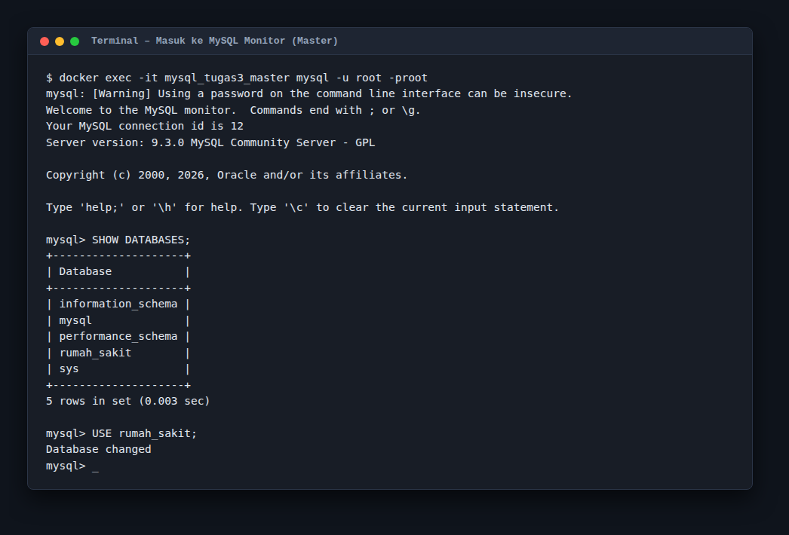

---

### A.4 Memeriksa Status Storage Engine InnoDB

Transaksi ACID pada MySQL mensyaratkan penggunaan *storage engine* transaksional, yaitu **InnoDB**. Periksa status engine dari tabel-tabel basis data `rumah_sakit`:

```sql
SHOW TABLE STATUS FROM rumah_sakit WHERE Name IN ('pasien', 'dokter', 'administrator')\G
```

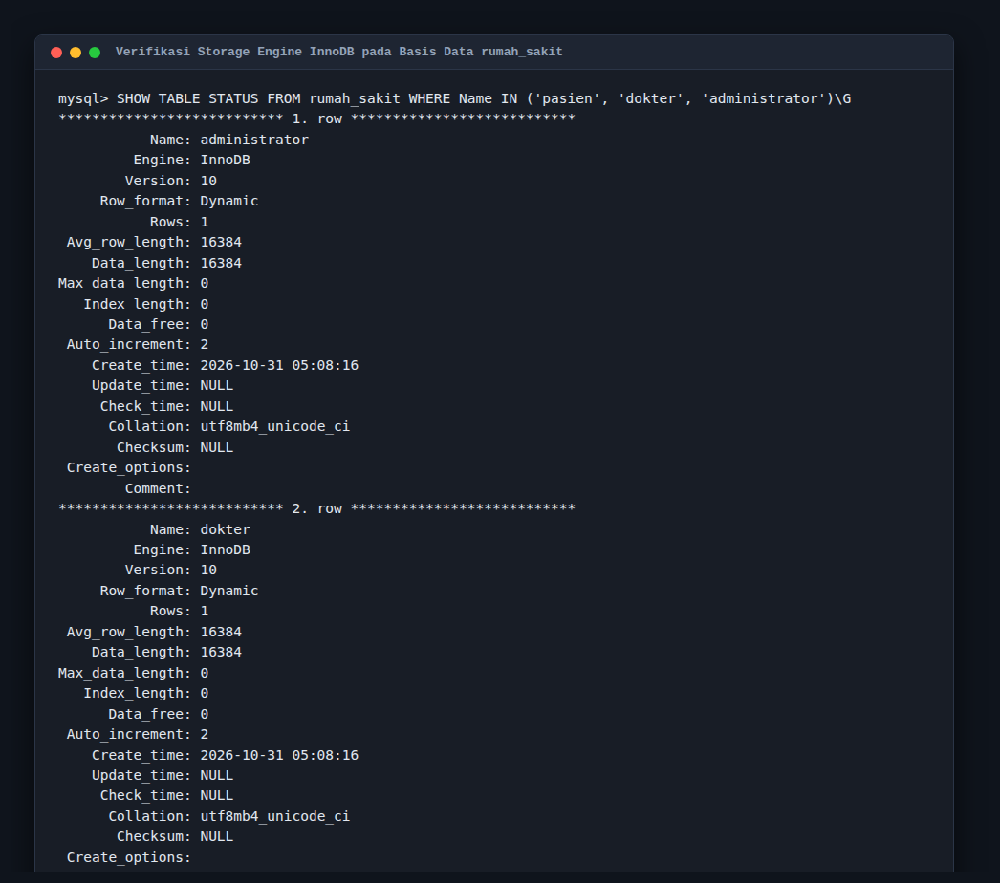

Hasil pemeriksaan membuktikan seluruh tabel telah menggunakan `Engine: InnoDB`, sehingga fitur transaksi, rollback, foreign key constraint, dan crash recovery didukung secara penuh.

---

### A.5 Praktikum Kontrol Transaksi (Commit, Rollback, dan Savepoint)

#### 1) Pengujian Transaksi 1 (Tanpa Commit)
Pada pengujian pertama, dibuat stored procedure `transaksi1` yang menyisipkan data pasien baru (`id_pasien=6`, `nama_pasien='Tito'`), namun transaksi sengaja **tidak diakhiri** dengan perintah `COMMIT;`.

```sql
DELIMITER $$
CREATE PROCEDURE transaksi1()
BEGIN
  START TRANSACTION;
  INSERT INTO pasien (id_pasien, nama_pasien, alamat_pasien, jenis_kelamin)
  VALUES (6, 'Tito', 'Jl Pakis haji no 25', 1);
END$$
DELIMITER ;
```

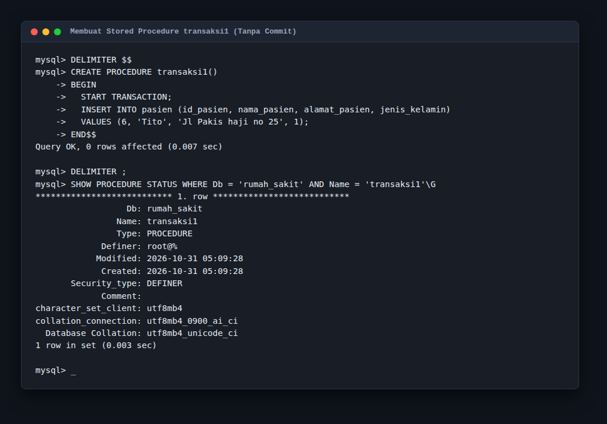

Jalankan prosedur dengan perintah `CALL transaksi1();`, lalu periksa isi tabel `pasien` pada sesi koneksi yang baru:

```sql
CALL transaksi1();
SELECT * FROM pasien;
```

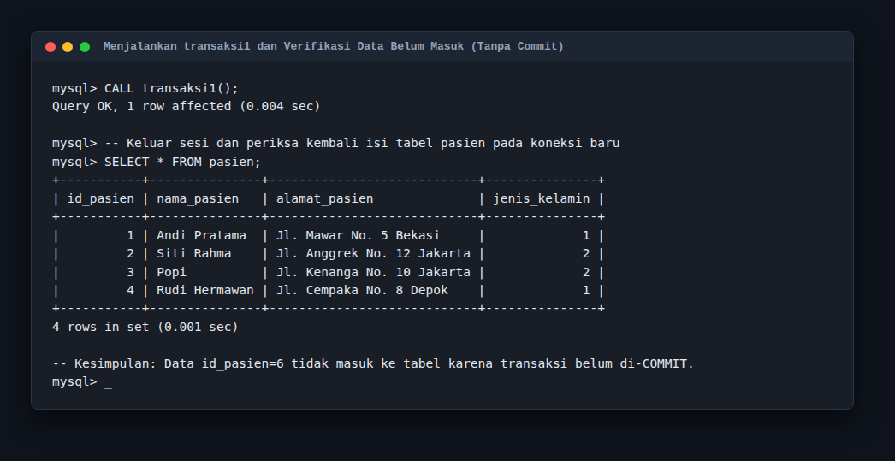

**Analisis:** Data pasien Tito (`id_pasien=6`) tidak tersimpan di dalam basis data. Hal ini membuktikan prinsip transaksi bahwa perubahan data dalam transaksi yang tidak di-`COMMIT` bersifat sementara dan akan dibatalkan (*auto-rollback*) saat sesi berakhir.

---

#### 2) Pengujian Transaksi 2 (Dengan Commit)
Modifikasi prosedur transaksi dengan menambahkan perintah `COMMIT;` di akhir blok perintah:

```sql
DELIMITER $$
CREATE PROCEDURE transaksi2()
BEGIN
  START TRANSACTION;
  INSERT INTO pasien (id_pasien, nama_pasien, alamat_pasien, jenis_kelamin)
  VALUES (6, 'Tito', 'Jl Pakis haji no 25', 1);
  COMMIT;
END$$
DELIMITER ;
```

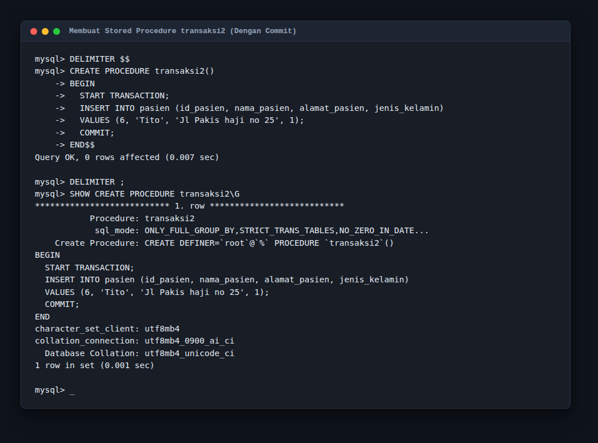

Jalankan prosedur `transaksi2()` dan periksa isi tabel `pasien`:

```sql
CALL transaksi2();
SELECT * FROM pasien;
```

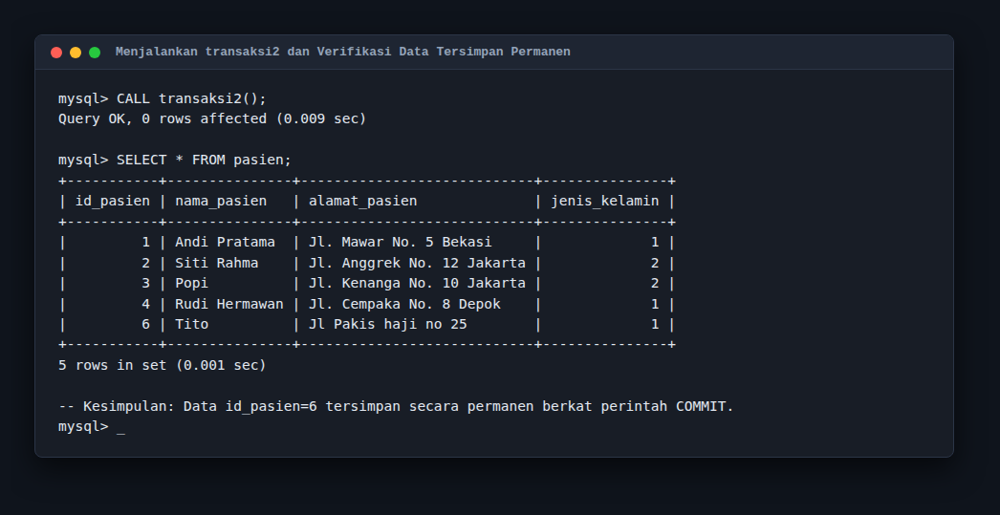

**Analisis:** Data pasien Tito (`id_pasien=6`) sekarang telah tersimpan permanen di dalam tabel `pasien` karena pernyataan transaksi telah disahkan secara permanen (*committed*).

---

#### 3) Pengujian Transaksi 3 (Rollback Sederhana)
Pernyataan `ROLLBACK` digunakan untuk membatalkan seluruh operasi yang sedang berjalan sebelum transaksi disahkan. Sebagai contoh, dilakukan perintah update nama pasien `id_pasien=3` (yang awalnya bernama 'Popi') menjadi 'Danar', diikuti perintah `ROLLBACK;`:

```sql
START TRANSACTION;
UPDATE pasien SET nama_pasien = 'Danar' WHERE id_pasien = 3;
ROLLBACK;

SELECT * FROM pasien WHERE id_pasien = 3;
```

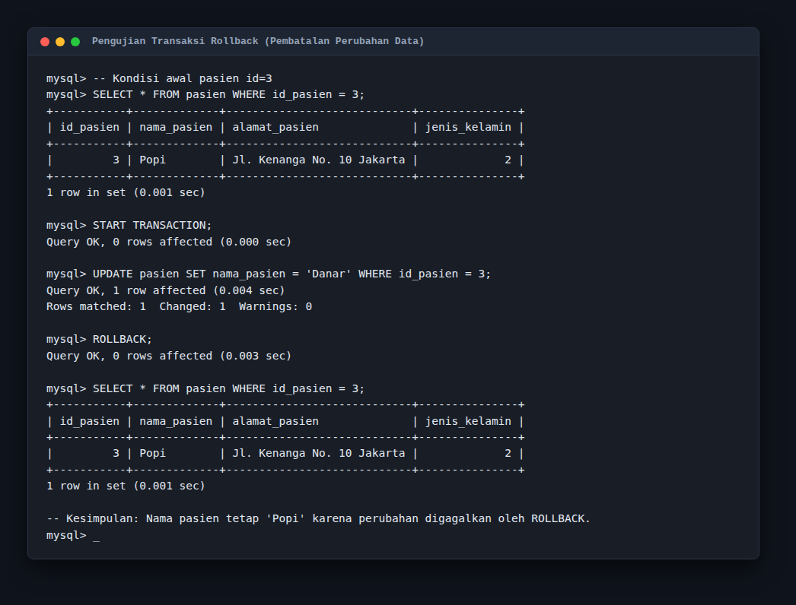

**Analisis:** Nama pasien dengan `id_pasien=3` tetap bernilai 'Popi'. Perubahan nama menjadi 'Danar' berhasil digagalkan dan kondisi data dikembalikan persis ke titik awal sebelum transaksi dimulai.

---

#### 4) Pengujian Transaksi 4 (Rollback Parsial & Commit)
Skenario transaksi 4 melakukan penyisipan pasien baru (`id_pasien=7`, nama 'Septin') yang kemudian di-`ROLLBACK`, diikuti pembaruan nama pasien `id_pasien=3` menjadi 'Septin' yang di-`COMMIT`:

```sql
DELIMITER $$
CREATE PROCEDURE transaksi4()
BEGIN
  START TRANSACTION;
  INSERT INTO pasien (id_pasien, nama_pasien, alamat_pasien, jenis_kelamin)
  VALUES (7, 'Septin', 'Jl Anggrek no 5', 2);
  ROLLBACK;
  
  START TRANSACTION;
  UPDATE pasien SET nama_pasien = 'Septin' WHERE id_pasien = 3;
  COMMIT;
END$$
DELIMITER ;

CALL transaksi4();
SELECT * FROM pasien WHERE id_pasien IN (3, 7);
```

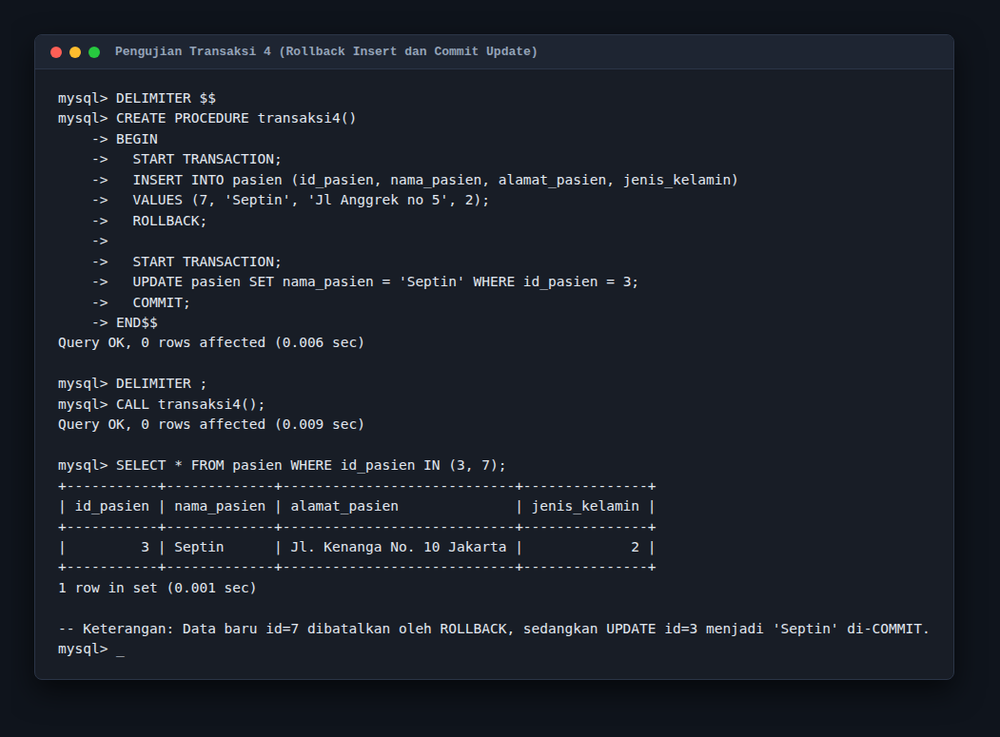

**Analisis:** Data `id_pasien=7` tidak masuk ke dalam tabel karena dibatalkan oleh `ROLLBACK`, sedangkan data `id_pasien=3` berhasil diperbarui namanya menjadi 'Septin' karena transaksi kedua disahkan oleh `COMMIT`.

---

#### 5) Pengujian Transaksi 5 (Savepoint / Check Point)
*Savepoint* memungkinkan transaksi di-rollback secara parsial ke titik tertentu tanpa harus membatalkan seluruh isi transaksi:

```sql
DELIMITER $$
CREATE PROCEDURE transaksi5()
BEGIN
  START TRANSACTION;
  INSERT INTO pasien (id_pasien, nama_pasien, alamat_pasien, jenis_kelamin)
  VALUES (7, 'Dedi', 'Jl Melati no 1', 1);
  SAVEPOINT point1;
  
  INSERT INTO pasien (id_pasien, nama_pasien, alamat_pasien, jenis_kelamin)
  VALUES (8, 'Riko', 'Jl Mawar no 2', 1);
  ROLLBACK TO point1;
  
  INSERT INTO pasien (id_pasien, nama_pasien, alamat_pasien, jenis_kelamin)
  VALUES (9, 'Maya', 'Jl Melur no 3', 2);
  COMMIT;
END$$
DELIMITER ;

CALL transaksi5();
SELECT * FROM pasien WHERE id_pasien >= 6 ORDER BY id_pasien ASC;
```

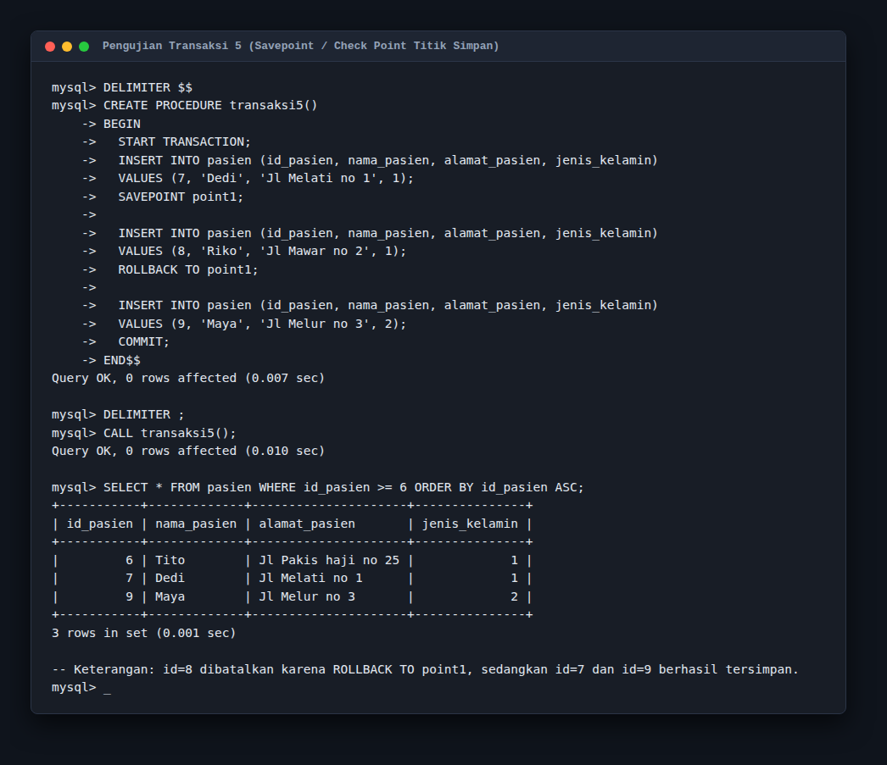

**Analisis:** Pasien Dedi (`id=7`) dan Maya (`id=9`) berhasil tersimpan, sedangkan pasien Riko (`id=8`) berhasil digagalkan karena dibatalkan ke titik `SAVEPOINT point1`.

---

### A.6 Praktikum Trigger Pengurangan Stok Obat

#### 1) Membuat Tabel `obat`
Tabel `obat` menyimpan data master katalog obat dan stok persediaan:

```sql
CREATE TABLE obat (
  id_obat INT(6) AUTO_INCREMENT PRIMARY KEY,
  kode_obat VARCHAR(5),
  nama_obat VARCHAR(30),
  harga INT(10),
  stok INT(5)
) ENGINE=InnoDB;

DESC obat;
```

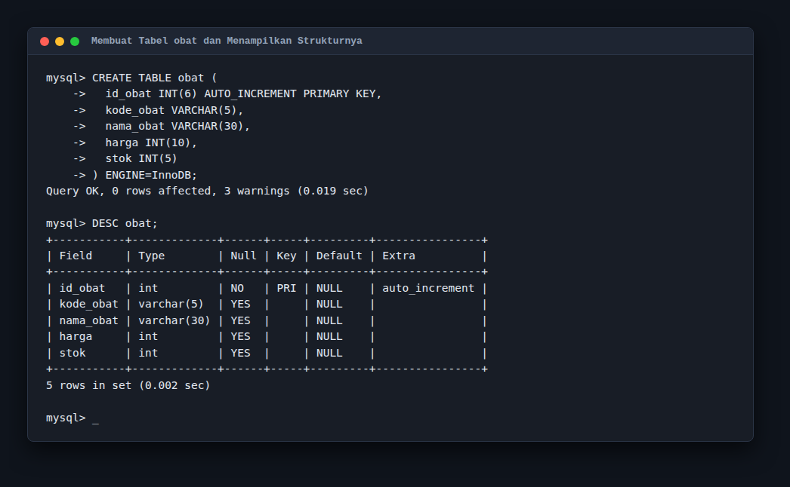

---

#### 2) Membuat Tabel `transaksi_obat`
Tabel `transaksi_obat` mencatat transaksi dan memiliki relasi *Foreign Key* ke tabel `pasien` dan `obat`:

```sql
CREATE TABLE transaksi_obat (
  id_transaksi INT(3) AUTO_INCREMENT PRIMARY KEY,
  id_pasien INT(3),
  id_obat INT(3),
  jumlah INT(10),
  total_harga INT(10),
  CONSTRAINT fk_transaksi_pasien FOREIGN KEY (id_pasien) REFERENCES pasien(id_pasien) ON DELETE CASCADE,
  CONSTRAINT fk_transaksi_obat FOREIGN KEY (id_obat) REFERENCES obat(id_obat) ON DELETE CASCADE
) ENGINE=InnoDB;

DESC transaksi_obat;
```

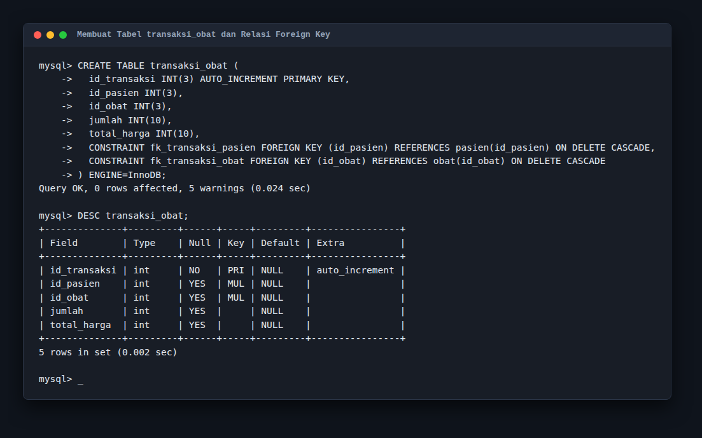

---

#### 3) Membuat Trigger `tg_jual`
Sebelum membuat trigger, isi data awal tabel `obat` dengan 3 jenis obat (Amoxillin stok 20, Paracetamol stok 50, dan Antasida stok 30). Kemudian rancang trigger `tg_jual`:

```sql
INSERT INTO obat (id_obat, kode_obat, nama_obat, harga, stok) VALUES
(1, 'A001', 'Amoxillin', 5000, 20),
(2, 'A002', 'Paracetamol', 3000, 50),
(3, 'A003', 'Antasida', 4000, 30);

DELIMITER $$
CREATE TRIGGER tg_jual
AFTER INSERT ON transaksi_obat
FOR EACH ROW
BEGIN
  UPDATE obat
  SET stok = stok - NEW.jumlah
  WHERE id_obat = NEW.id_obat;
END$$
DELIMITER ;
```

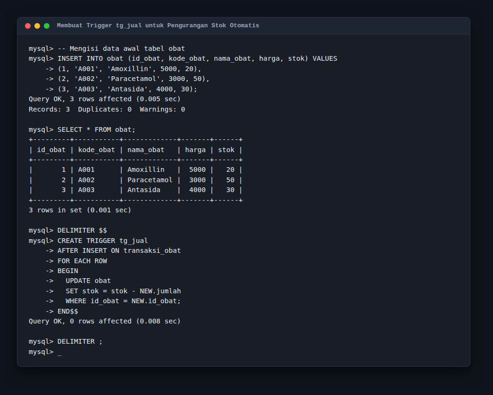

---

#### 4) Pengujian Trigger Pengurangan Stok
Lakukan pengujian transaksi dengan menyimulasikan pasien (`id_pasien=3`) membeli 5 unit obat Amoxillin (`id_obat=1`):

```sql
INSERT INTO transaksi_obat (id_pasien, id_obat, jumlah, total_harga)
VALUES (3, 1, 5, 25000);

SELECT * FROM transaksi_obat;
SELECT * FROM obat;
```

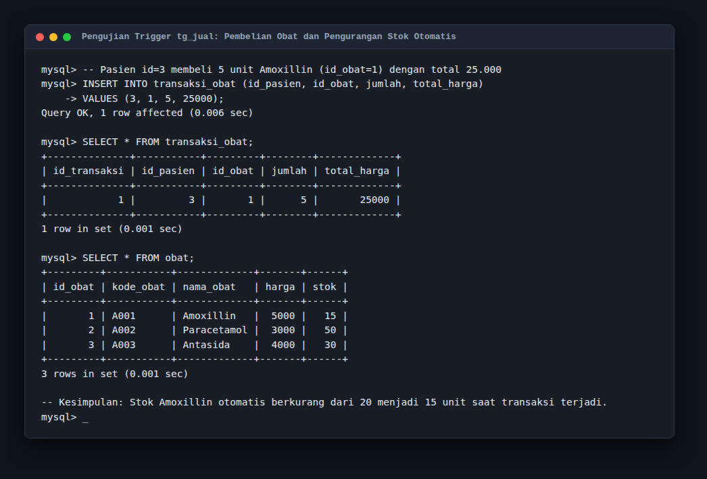

**Analisis:** Stok obat Amoxillin yang semula berjumlah 20 unit secara otomatis berkurang menjadi **15 unit**. Trigger `tg_jual` berhasil mendeteksi event `AFTER INSERT` dan memperbarui data stok secara akurat dan konsisten.

---

### A.7 Praktikum Basis Data Terdistribusi (Replikasi Master–Slave)

#### 1) Konfigurasi Server Master & Pembuatan User Replikasi
Pada server Master, binary logging telah diaktifkan (`server-id=1`, `log-bin=mysql-bin`, `binlog-do-db=rumah_sakit`). Selanjutnya dibuat user khusus bernama `prodisi` dengan hak akses replikasi:

```sql
CREATE USER 'prodisi'@'%' IDENTIFIED BY 'prodisi';
GRANT REPLICATION SLAVE, REPLICATION CLIENT ON *.* TO 'prodisi'@'%';
FLUSH PRIVILEGES;

SELECT user, host, plugin FROM mysql.user WHERE user = 'prodisi';
```

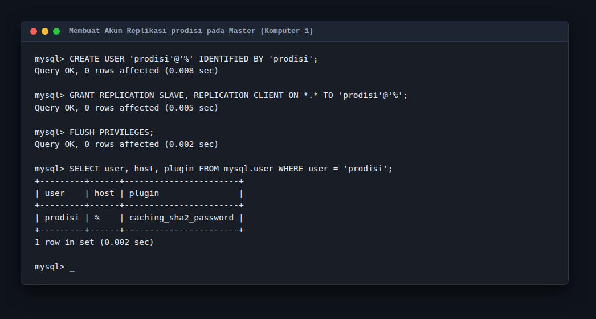

Periksa posisi binary log aktif pada Master menggunakan perintah:

```sql
SHOW BINARY LOG STATUS;
```

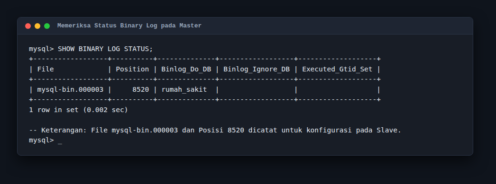

Tercatat file binary log adalah **`mysql-bin.000003`** pada posisi (*Position*) **`8520`**. Nilai ini digunakan untuk mengarahkan pointer replikasi pada server Slave.

---

#### 2) Konfigurasi Server Slave & Menjalankan Replikasi
Masuk ke terminal server Slave (Port 3307). Hubungkan server Slave ke server Master menggunakan parameter yang telah dicatat, kemudian jalankan thread replikasi:

```sql
STOP REPLICA;
CHANGE REPLICATION SOURCE TO
  SOURCE_HOST='mysql_master',
  SOURCE_USER='prodisi',
  SOURCE_PASSWORD='prodisi',
  SOURCE_PORT=3306,
  SOURCE_LOG_FILE='mysql-bin.000003',
  SOURCE_LOG_POS=8520,
  GET_SOURCE_PUBLIC_KEY=1;
START REPLICA;
```

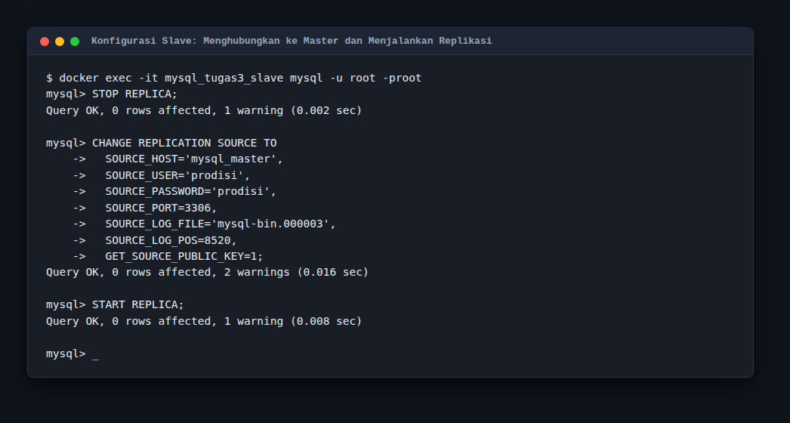

Periksa status kesehatan replikasi pada Slave:

```sql
SHOW REPLICA STATUS\G
```

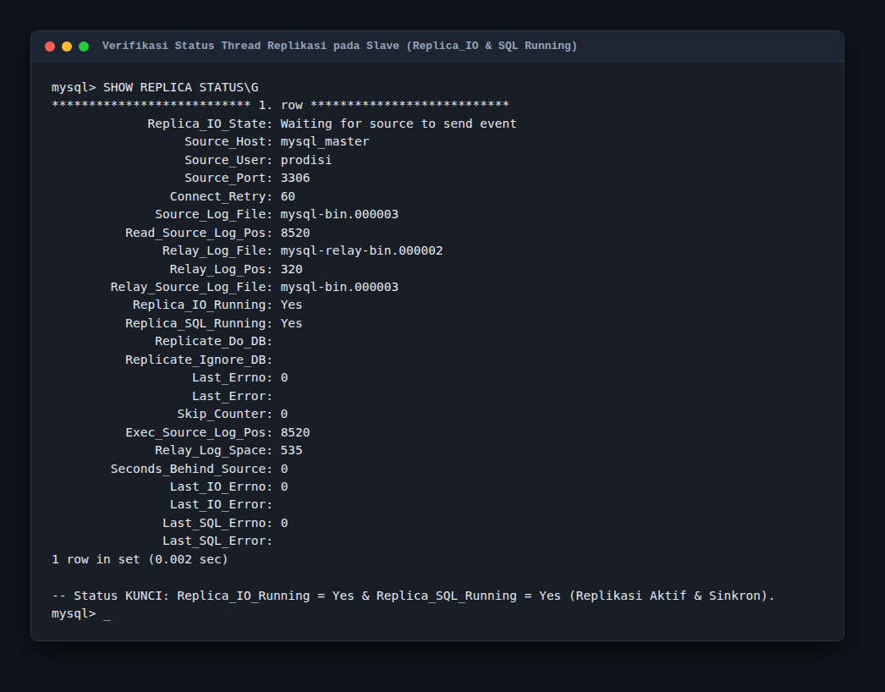

**Verifikasi Status Kunci:**
- `Replica_IO_Running: Yes` (Slave berhasil terhubung ke Master dan membaca binary log stream).
- `Replica_SQL_Running: Yes` (Slave berhasil mengeksekusi transaksi dari relay log).
- `Seconds_Behind_Source: 0` (Tidak ada delay/antrean data replikasi).
- `Last_IO_Errno: 0` dan `Last_SQL_Errno: 0` (Kondisi replikasi bebas kesalahan).

---

#### 3) Pengujian Replikasi Data Nyata (Master ke Slave)
Untuk membuktikan bahwa sistem basis data terdistribusi telah berfungsi penuh secara *real-time*, dilakukan penambahan satu obat baru pada server Master (Port 3306): obat **Demam** (`kode_obat='A005'`, `harga=150`, `stok=100`):

```sql
-- [EKSEKUSI PADA SERVER MASTER (Port 3306)]
INSERT INTO obat (kode_obat, nama_obat, harga, stok)
VALUES ('A005', 'Demam', 150, 100);

SELECT * FROM obat;
```

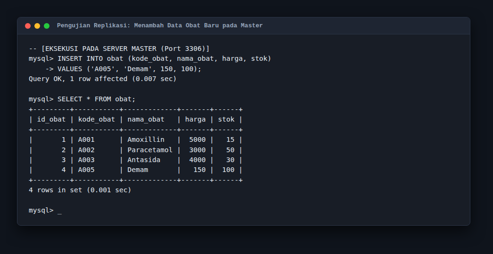

Segera periksa data pada server Slave (Port 3307) tanpa melakukan input manual apapun di Slave:

```sql
-- [PEMERIKSAAN PADA SERVER SLAVE (Port 3307)]
SELECT * FROM obat;
```

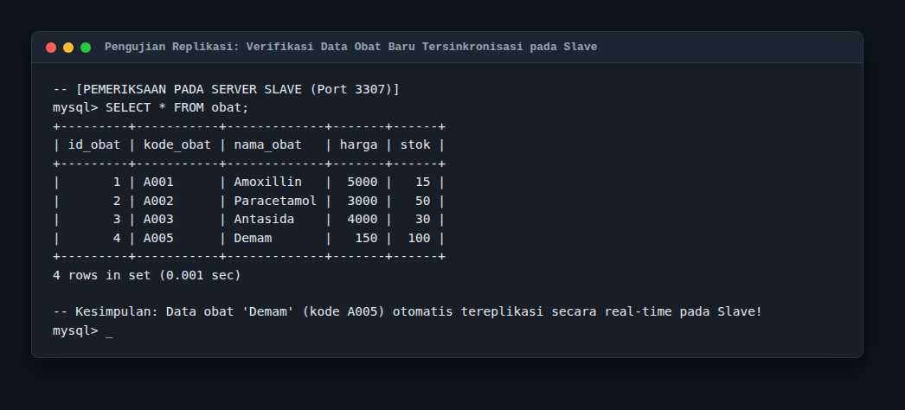

**Analisis:** Record obat baru 'Demam' (`id_obat=4`, `kode_obat='A005'`) langsung muncul pada basis data Slave secara instan. Ini membuktikan proses replikasi basis data terdistribusi telah berjalan dengan sempurna.

---

## B. Hasil Praktik

Dari serangkaian praktikum yang telah dilakukan, diperoleh rekapitulasi hasil sebagai berikut:

| No | Modul Pengujian | Skenario Uji | Hasil yang Diharapkan | Hasil Pengujian Nyata | Status |
| :---: | :--- | :--- | :--- | :--- | :---: |
| 1 | **Storage Engine** | Cek engine tabel basis data `rumah_sakit` | Bertipe `InnoDB` | Seluruh tabel berstatus `Engine: InnoDB` | **BERHASIL** |
| 2 | **Transaksi 1** | Insert pasien ID 6 tanpa `COMMIT` | Data tidak tersimpan | Data tidak tersimpan di tabel `pasien` | **BERHASIL** |
| 3 | **Transaksi 2** | Insert pasien ID 6 dengan `COMMIT` | Data tersimpan permanen | Data Tito (`id=6`) tersimpan di basis data | **BERHASIL** |
| 4 | **Transaksi 3** | Update nama Popi -> Danar + `ROLLBACK` | Perubahan dibatalkan | Nama pasien tetap 'Popi' | **BERHASIL** |
| 5 | **Transaksi 4** | Rollback insert & Commit update nama | Insert batal, update sah | Data baru dibatalkan, nama berubah 'Septin' | **BERHASIL** |
| 6 | **Transaksi 5** | Insert bertahap dengan `SAVEPOINT point1` | ID 8 dibatalkan, ID 7 & 9 masuk | ID 7 (Dedi) & ID 9 (Maya) masuk; ID 8 batal | **BERHASIL** |
| 7 | **Trigger `tg_jual`** | Pembelian 5 unit Amoxillin (stok 20) | Stok berkurang otomatis jadi 15 | Stok Amoxillin di tabel `obat` menjadi 15 | **BERHASIL** |
| 8 | **Koneksi Replikasi** | Slave terhubung ke Master via user `prodisi` | Thread IO & SQL aktif (`Yes`) | `Replica_IO_Running: Yes`, `SQL_Running: Yes` | **BERHASIL** |
| 9 | **Sinkronisasi Replikasi** | Insert obat 'Demam' A005 di Master | Data otomatis muncul di Slave | Data 'Demam' langsung tampil di server Slave | **BERHASIL** |

---

## C. Pembahasan Teknis

### C.1 Prinsip ACID & Peran Storage Engine InnoDB
Transaksi merupakan unit kerja logika (*logical unit of work*) yang harus memenuhi kaidah ACID:
- **Atomicity:** Seluruh operasi dalam transaksi harus berhasil seluruhnya atau tidak sama sekali. Terbukti pada `transaksi1` dan `transaksi3`, ketiadaan commit atau adanya rollback membatalkan seluruh efek operasi.
- **Consistency:** Basis data bertransisi dari satu status valid ke status valid lainnya, dengan integritas constraint relasional yang tetap terjaga.
- **Isolation:** Operasi yang belum disahkan tidak dapat dilihat oleh transaksi lain, mencegah fenomena *dirty read*.
- **Durability:** Setelah perintah `COMMIT` dieksekusi (seperti pada `transaksi2`), perubahan data dijamin tersimpan permanen ke disk walau terjadi restart sistem.

MySQL menyediakan *storage engine* InnoDB yang memiliki kapabilitas *redo log* dan *undo log* untuk mengelola isolasi transaksi dan mekanisme *rollback segment*.

### C.2 Mekanisme Otomatisasi Integritas Data via Trigger
Trigger adalah objek basis data yang terikat pada suatu tabel dan dieksekusi secara otomatis saat terjadi event DML (`INSERT`, `UPDATE`, atau `DELETE`). Pada praktikum ini, trigger `tg_jual` beroperasi dengan spesifikasi:
- Event: `AFTER INSERT ON transaksi_obat`
- Granularitas: `FOR EACH ROW`
- Variabel Pseudorow: Menggunakan `NEW.id_obat` untuk mengidentifikasi obat yang dibeli dan `NEW.jumlah` untuk mengambil kuantitas pembelian.

Penerapan trigger memindahkan logika bisnis pemotongan persediaan langsung ke layer DBMS, sehingga mencegah inkonsistensi stok akibat kesalahan kode di layer aplikasi (*data integrity enforcement*).

### C.3 Arsitektur Basis Data Terdistribusi (Replikasi Master–Slave)
Replikasi data pada MySQL bekerja secara asinkron (*asynchronous replication*) dengan alur sebagai berikut:
1. Setiap transaksi tulis (DML/DDL) yang terjadi pada **Master** dicatat ke dalam **Binary Log** (`mysql-bin`).
2. Server **Slave** menjalankan **Replica I/O Thread** yang terhubung ke Master menggunakan akun khusus (`prodisi`). Thread ini membaca rekaman binary log dari posisi terakhir (`MASTER_LOG_POS`) dan menulisnya ke dalam berkas **Relay Log** lokal (`mysql-relay-bin`).
3. Server **Slave** secara paralel menjalankan **Replica SQL Thread** yang membaca event dari Relay Log dan mengeksekusinya kembali pada basis data lokal Slave.
4. Melalui arsitektur ini, beban query baca (*read-heavy traffic*) dapat didistribusikan ke node Slave (*read scaling*), dan node Slave sekaligus berfungsi sebagai cadangan data (*failover redundancy*).

---

## D. Kata Penutup

Demikian laporan pelaksanaan **Tugas 3 Praktikum Transaksi dan Basis Data Terdistribusi (MSIM4206)** ini disusun. Melalui praktikum ini, telah berhasil dibuktikan implementasi manajemen transaksi ACID, otomasi kontrol integritas stok melalui trigger, serta konfigurasi dan sinkronisasi arsitektur basis data terdistribusi Master–Slave multi-node secara *real-time*.

Semoga laporan dan dokumentasi ini dapat memberikan gambaran komprehensif atas seluruh tahapan praktik yang telah dilaksanakan serta memenuhi seluruh kriteria penilaian akademik Universitas Terbuka. Terima kasih.
