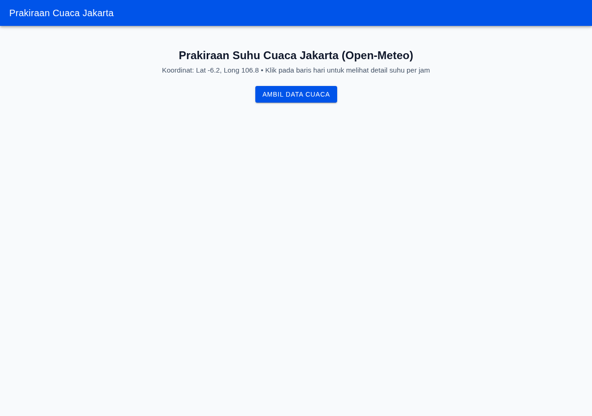
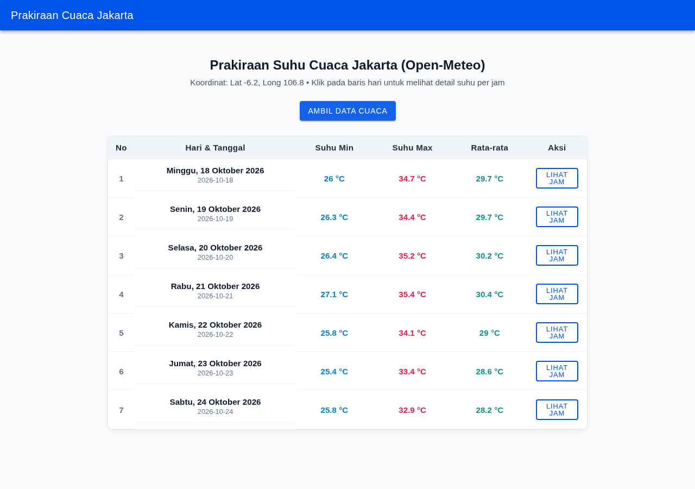
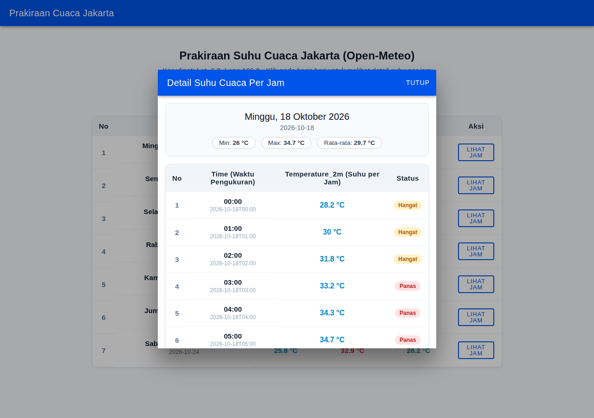

# LAPORAN PRAKTIKUM TUGAS 2
## PEMROGRAMAN BERBASIS PERANGKAT BERGERAK (MSIM4401)
### MODUL 04 - AKTIVITAS 08: PRAKTIKUM STRUKTUR DIREKTORI DAN ELEMEN IONIC MENGGUNAKAN VUE
**FOKUS MATERI: BAGIAN B. PRAKTIK: TARGET TAMPILAN DAN LOGIC**

---

### IDENTITAS MAHASISWA
- **Nama Mahasiswa** : Farhan Aditya
- **NIM**            : 054750333
- **Program Studi**    : Sistem Informasi
- **Fakultas**         : Sains dan Teknologi (FST)
- **Perguruan Tinggi** : Universitas Terbuka (UT)
- **Tahun Akademik**   : 2026 / 2027

---

## 1. PENDAHULUAN DAN TUJUAN PRAKTIKUM

### 1.1 Latar Belakang
Pada pengembangan aplikasi perangkat bergerak berbasis *hybrid/cross-platform* dengan ekosistem **Ionic Framework** dan **Vue.js**, struktur arsitektur kode sumber yang rapi dan modular menjadi fondasi utama agar aplikasi mudah dikembangkan (*maintainable*), diskalakan (*scalable*), dan diuji (*testable*). 

Berdasarkan modul ajar **MSIM4401 Modul 04 Aktivitas 08 Bagian B (*Praktik: Target Tampilan dan Logic*)**, pembuatan aplikasi yang mengonsumsi layanan web eksternal (*RESTful API*) tidak boleh mencampurkan logika panggilan jaringan HTTP secara langsung ke dalam berkas tampilan (*view/component*). Meskipun penulisan panggilan HTTP langsung di dalam blok template atau script view dapat berjalan secara fungsional, pola tersebut memiliki kelemahan arsitektural:
1. Kode tidak dapat digunakan kembali (*not reusable*) jika halaman lain membutuhkan data dari endpoint yang sama.
2. Pelanggaran prinsip *Separation of Concerns* (pemisahan tanggung jawab antara lapisan presentasi UI dan lapisan akses data).
3. Sulit melakukan penambahan fungsionalitas HTTP lain (seperti POST, PUT, DELETE) secara terpusat.

Oleh karena itu, modul mengarahkan perancangan sebuah kelas khusus (*service class*) di dalam direktori `src/services/` (khususnya `src/services/EndPointAccess/index.ts`) yang memanfaatkan pustaka **Axios**. Komponen tampilan (`Home.vue`) kemudian bertindak sebagai konsumen (*consumer*) yang menginstansiasi *service* tersebut untuk menyajikan data secara terstruktur melalui komponen antarmuka pengguna bawaan Ionic.

### 1.2 Tujuan Praktikum
1. Memahami dan mengimplementasikan struktur direktori dan file standar pada proyek Ionic berbasis Vue 3 dan TypeScript.
2. Membangun lapisan layanan akses RESTful API (*Service Layer*) menggunakan kelas `EndPointAccess` berbasis Axios sesuai *Listing 8.1* pada modul.
3. Membangun lapisan tampilan (*Presentation Layer*) pada berkas `src/views/Home.vue` dengan komponen resmi Ionic Framework (`ion-page`, `ion-header`, `ion-toolbar`, `ion-title`, `ion-content`, `ion-button`, `ion-modal`, `ion-spinner`) serta tabel responsif sesuai *Listing 8.2*.
4. Mengimplementasikan konfigurasi router dan navigasi pada berkas `src/router/index.ts` sesuai *Listing 8.3*.
5. Menyelesaikan studi kasus tugas 2: Mengonsumsi data API cuaca riil dari Open-Meteo untuk wilayah Jakarta (`latitude=-6.2&longitude=106.8&hourly=temperature_2m`), kemudian menampilkan atribut `time` (waktu pengukuran) dan `temperature_2m` (suhu per jam dalam °C) dalam format tabel yang informatif dan mudah dipahami.

---

## 2. STRUKTUR DIREKTORI DAN KONFIGURASI PROYEK

Mengacu pada Bagian A dan Bagian B Modul 04 Aktivitas 08, direktori proyek dipisahkan menjadi dua kelompok:
1. **Konfigurasi Root Proyek** (di luar direktori `src`): Berisi konfigurasi *package manager* (`package.json`, `bun.lock`), kompilator TypeScript (`tsconfig.json`), *bundler* Vite (`vite.config.ts`), serta berkas entri HTML (`index.html`).
2. **Kode Sumber Aplikasi (`src/`)**: Berisi seluruh logika aplikasi, komponen antarmuka, routing, dan *services*.

### 2.1 Pohon Direktori Proyek (`perangkat_bergerak/tugas 2`)
```
perangkat_bergerak/tugas 2/
├── .gitignore
├── bun.lock
├── dist/                              # Output kompilasi produksi
├── index.html                         # Berkas template HTML utama
├── MSIM4401_MDL4 Aktivitas 08 Final.pdf # Modul acuan praktikum
├── package.json                       # Konfigurasi dependensi dan skrip proyek
├── screenshots/                       # Bukti tangkapan layar pengujian
│   ├── 1_tampilan_awal.png
│   ├── 2_daftar_cuaca_harian.png
│   └── 3_modal_detail_per_jam.png
├── src/
│   ├── App.vue                        # Komponen root penampung ion-router-outlet
│   ├── main.ts                        # Titik masuk utama aplikasi (inisialisasi Ionic & CSS)
│   ├── shims-vue.d.ts                 # Deklarasi tipe TypeScript untuk berkas .vue
│   ├── router/
│   │   └── index.ts                   # Konfigurasi rute dan navigasi Ionic Vue Router
│   ├── services/
│   │   └── EndPointAccess/
│   │       └── index.ts               # Kelas Service akses RESTful API (Listing 8.1)
│   └── views/
│       └── Home.vue                   # Tampilan utama UI dan tabel data cuaca (Listing 8.2)
├── tsconfig.json                      # Konfigurasi TypeScript & path alias (@/*)
└── vite.config.ts                     # Konfigurasi Vite & plugin Vue
```

### 2.2 Penjelasan Pustaka dan Dependensi (`package.json`)
Sesuai instruksi modul pada halaman 8.8, dependensi utama yang digunakan meliputi:
- `@ionic/vue` & `@ionic/vue-router`: Pustaka komponen seluler (Mobile UI Components) dan sistem routing berbasis Ionic v8.
- `vue` & `vue-router`: Framework inti Vue 3 dan sistem navigasi URL.
- `axios` & `@types/axios`: HTTP Client berbasis Promise untuk komunikasi asynchronous ke RESTful API endpoint.
- `typescript` & `vue-tsc`: Kompilator pemeriksaan tipe statis.
- `vite`: Alat pengembangan dan *bundler* modern berkecepatan tinggi.

---

## 3. IMPLEMENTASI KODE PROGRAM DAN ANALISIS BARIS PER BARIS

Bagian ini membahas implementasi kode sumber secara komprehensif sesuai penomoran penjelas `// <n>` yang tercantum pada Bagian B dan C dari Modul Aktivitas 08.

### 3.1 Lapisan Akses Endpoint: `src/services/EndPointAccess/index.ts`
Berkas ini mengimplementasikan kelas `EndPointAccess` yang membungkus pemanggilan Axios untuk mengambil data dari endpoint eksternal.

#### Kode Program (`src/services/EndPointAccess/index.ts`)
```typescript
import axios, { type AxiosResponse } from 'axios';

// <1>

export default class EndPointAccess {
  theUrl: string;

  constructor(url: string) {
    const trimmedUrl = url?.trim();
    if (!trimmedUrl) {
      throw new Error('Endpoint URL cannot be empty.');
    }
    this.theUrl = trimmedUrl;

    // <2>
    // <3>
  }

  async getRes<T = unknown>(): Promise<AxiosResponse<T>> {
    // <4>
    try {
      const response = await axios.get<T>(this.theUrl);
      return response;
    } catch (error) {
      const errorMessage =
        error instanceof Error ? error.message : 'Unknown network error';
      throw new Error(`Failed to fetch data from ${this.theUrl}: ${errorMessage}`);
    }
  }
}
```

#### Analisis Penanda Listing 8.1 (`// <n>`):
- **`// <1>` (Pustaka Axios)**: Mengimpor pustaka `axios` ke dalam modul TypeScript. Axios dipilih karena merupakan pustaka HTTP request berbasis Promise yang andal, mendukung pembatalan request, transformasi otomatis respon JSON, dan memiliki kompatibilitas luas baik di browser maupun webview mobile.
- **`// <2>` (Definisi Kelas)**: Mendefinisikan kelas `EndPointAccess` yang di-export sebagai modul bawaan (`export default`). Kelas ini mengisolasi konfigurasi dan mekanisme komunikasi HTTP, sehingga komponen tampilan tidak perlu mengetahui detail teknis *networking*.
- **`// <3>` (Konstruktor Kelas)**: Konstruktor menerima parameter `url: string` dan menyimpannya ke atribut properti `this.theUrl`. Pada kode ini juga ditambahkan validasi pertahanan (*defensive programming*) untuk memastikan URL tidak kosong sebelum disimpan.
- **`// <4>` (Metode Asynchronous `getRes()`)**: Metode asinkron (`async`) yang mengeksekusi `await axios.get<T>(this.theUrl)` dan mengembalikan Promise berupa objek `AxiosResponse`. Penggunaan blok `try-catch` memastikan jika terjadi kegagalan koneksi jaringan atau endpoint tidak dapat dihubungi, sistem melempar pesan *error* yang deskriptif (*Fail Fast*).

---

### 3.2 Lapisan Tampilan dan Logika Antarmuka: `src/views/Home.vue`
Berkas `Home.vue` mengimplementasikan tampilan antarmuka berbasis Ionic Vue untuk memicu pemanggilan API cuaca dan menyajikan data atribut `time` serta `temperature_2m` ke dalam format tabel yang mudah dibaca.

#### Struktur Kode Program (`src/views/Home.vue`)

```html
<template>
  <ion-page>
    <!-- Header Aplikasi -->
    <ion-header :translucent="true">
      <ion-toolbar color="primary">
        <ion-title>Prakiraan Cuaca Jakarta</ion-title>
      </ion-toolbar>
    </ion-header>

    <!-- Konten Utama Halaman -->
    <ion-content :fullscreen="true" class="ion-padding page-content">
      <div id="container">
        <!-- Informasi Header Cuaca -->
        <header class="app-header">
          <h2>Prakiraan Suhu Cuaca Jakarta (Open-Meteo)</h2>
          <p class="subtitle">
            Koordinat: Lat -6.2, Long 106.8 &bull; Klik pada baris hari untuk melihat detail suhu per jam
          </p>
        </header>

        <!-- Tombol Aksi Ambil Data -->
        <div class="action-section">
          <ion-button @click="ambilData" :disabled="isLoading">
            {{ isLoading ? 'Mengambil Data...' : 'Ambil Data Cuaca' }}
          </ion-button>
        </div>

        <!-- Status Loading Spinner -->
        <div v-if="isLoading" class="loading-state">
          <ion-spinner name="crescent"></ion-spinner>
          <p>Sedang mengambil data cuaca dari Open-Meteo API...</p>
        </div>

        <!-- Notifikasi Pesan Error -->
        <div v-if="errorMessage" class="error-state">
          <p class="error-text">{{ errorMessage }}</p>
        </div>

        <!-- Tabel Ringkasan Prakiraan Harian (Listing 8.2 <1>) -->
        <section v-if="daysList.length > 0" class="results-section">
          <div class="table-wrapper">
            <table class="days-table">
              <thead>
                <tr>
                  <th scope="col">No</th>
                  <th scope="col">Hari &amp; Tanggal</th>
                  <th scope="col">Suhu Min</th>
                  <th scope="col">Suhu Max</th>
                  <th scope="col">Rata-rata</th>
                  <th scope="col">Aksi</th>
                </tr>
              </thead>
              <tbody>
                <!-- // <1> Menampilkan hasil perulangan v-for dari data respon -->
                <tr
                  v-for="(day, index) in daysList"
                  :key="day.dateKey"
                  class="day-row"
                  @click="openDayDetail(day)"
                >
                  <td class="col-num">{{ index + 1 }}</td>
                  <td class="day-info">
                    <span class="day-title">{{ day.dayLabel }}</span>
                    <span class="date-badge">{{ day.dateKey }}</span>
                  </td>
                  <td class="temp-val temp-min">{{ day.minTemp }} {{ tempUnit }}</td>
                  <td class="temp-val temp-max">{{ day.maxTemp }} {{ tempUnit }}</td>
                  <td class="temp-val temp-avg">{{ day.avgTemp }} {{ tempUnit }}</td>
                  <td class="action-cell">
                    <ion-button
                      size="small"
                      fill="outline"
                      @click.stop="openDayDetail(day)"
                    >
                      Lihat Jam
                    </ion-button>
                  </td>
                </tr>
              </tbody>
            </table>
          </div>
        </section>
      </div>

      <!-- Modal Dialog: Detail Data Per Jam (time dan temperature_2m) -->
      <ion-modal :is-open="isModalOpen" @didDismiss="closeModal">
        <ion-header>
          <ion-toolbar color="primary">
            <ion-title>Detail Suhu Cuaca Per Jam</ion-title>
            <ion-buttons slot="end">
              <ion-button @click="closeModal">Tutup</ion-button>
            </ion-buttons>
          </ion-toolbar>
        </ion-header>

        <ion-content class="ion-padding modal-content">
          <div v-if="selectedDay" class="modal-body">
            <div class="day-summary-card">
              <h3>{{ selectedDay.dayLabel }}</h3>
              <p class="date-caption">{{ selectedDay.dateKey }}</p>
              <div class="stat-pills">
                <span class="stat-pill">Min: <strong>{{ selectedDay.minTemp }} {{ tempUnit }}</strong></span>
                <span class="stat-pill">Max: <strong>{{ selectedDay.maxTemp }} {{ tempUnit }}</strong></span>
                <span class="stat-pill">Rata-rata: <strong>{{ selectedDay.avgTemp }} {{ tempUnit }}</strong></span>
              </div>
            </div>

            <!-- Tabel Data Per Jam Sesuai Soal Tugas -->
            <div class="table-wrapper">
              <table class="hourly-table">
                <thead>
                  <tr>
                    <th scope="col">No</th>
                    <th scope="col">Time (Waktu Pengukuran)</th>
                    <th scope="col">Temperature_2m (Suhu per Jam)</th>
                    <th scope="col">Status</th>
                  </tr>
                </thead>
                <tbody>
                  <tr v-for="(hourItem, idx) in selectedDay.hours" :key="hourItem.time">
                    <td class="col-num">{{ idx + 1 }}</td>
                    <td class="time-col">
                      <span class="time-clock">{{ hourItem.hour }}</span>
                      <span class="time-raw">{{ hourItem.time }}</span>
                    </td>
                    <td class="temp-col">
                      <strong>{{ hourItem.temperature }} {{ tempUnit }}</strong>
                    </td>
                    <td>
                      <span :class="['badge-status', getTempBadgeClass(hourItem.temperature)]">
                        {{ getTempBadgeLabel(hourItem.temperature) }}
                      </span>
                    </td>
                  </tr>
                </tbody>
              </table>
            </div>
          </div>
        </ion-content>
      </ion-modal>
    </ion-content>
  </ion-page>
</template>

<script lang="ts">
import {
  IonContent,
  IonHeader,
  IonPage,
  IonTitle,
  IonToolbar,
  IonButton,
  IonButtons,
  IonModal,
  IonSpinner,
} from '@ionic/vue';
import { defineComponent } from 'vue';

// <2> Meng-import class EndPointAccess yang sudah dibuat
import EndPointAccess from '@/services/EndPointAccess';

// Tipe data response dari Open-Meteo Weather API
interface OpenMeteoResponse {
  latitude: number;
  longitude: number;
  hourly_units: {
    time: string;
    temperature_2m: string;
  };
  hourly: {
    time: string[];
    temperature_2m: number[];
  };
}

export interface WeatherItem {
  time: string;
  hour: string;
  temperature: number;
}

export interface DaySummary {
  dateKey: string;
  dayLabel: string;
  minTemp: number;
  maxTemp: number;
  avgTemp: number;
  hours: WeatherItem[];
}

const WEATHER_API_URL =
  'https://api.open-meteo.com/v1/forecast?latitude=-6.2&longitude=106.8&hourly=temperature_2m';

// Helper pemformat tanggal Indonesia
const formatDayLabel = (dateStr: string): string => {
  try {
    const date = new Date(`${dateStr}T00:00:00`);
    return date.toLocaleDateString('id-ID', {
      weekday: 'long',
      day: 'numeric',
      month: 'long',
      year: 'numeric',
    });
  } catch {
    return dateStr;
  }
};

// Helper transformasi array paralel time dan temperature_2m menjadi agregasi harian
const groupHourlyByDay = (
  times: string[],
  temps: number[],
): DaySummary[] => {
  const dayMap = new Map<string, WeatherItem[]>();

  times.forEach((timeStr, index) => {
    const parts = timeStr.split('T');
    const dateKey = parts[0];
    const hourPart = parts[1] || timeStr;

    const item: WeatherItem = {
      time: timeStr,
      hour: hourPart,
      temperature: temps[index],
    };

    if (!dayMap.has(dateKey)) {
      dayMap.set(dateKey, []);
    }
    dayMap.get(dateKey)!.push(item);
  });

  return Array.from(dayMap.entries()).map(([dateKey, items]) => {
    const tempValues = items.map((i) => i.temperature);
    const minTemp = Math.min(...tempValues);
    const maxTemp = Math.max(...tempValues);
    const avgTemp = Number(
      (tempValues.reduce((sum, v) => sum + v, 0) / tempValues.length).toFixed(1),
    );

    return {
      dateKey,
      dayLabel: formatDayLabel(dateKey),
      minTemp,
      maxTemp,
      avgTemp,
      hours: items,
    };
  });
};

export default defineComponent({
  name: 'Home',
  components: {
    IonContent,
    IonHeader,
    IonPage,
    IonTitle,
    IonToolbar,
    IonButton,
    IonButtons,
    IonModal,
    IonSpinner,
  },
  // <3> & <4> Menyiapkan variabel reaktif untuk menampung data dan state
  data() {
    return {
      daysList: [] as DaySummary[],
      selectedDay: null as DaySummary | null,
      isModalOpen: false,
      tempUnit: '°C',
      isLoading: false,
      errorMessage: '',
    };
  },
  methods: {
    // <5> Method yang dieksekusi saat tombol Ambil Data Cuaca di-klik
    async ambilData(): Promise<void> {
      this.isLoading = true;
      this.errorMessage = '';

      try {
        // Instansiasi kelas EndPointAccess dengan URL Open-Meteo
        const endpointService = new EndPointAccess(WEATHER_API_URL);
        const response = await endpointService.getRes<OpenMeteoResponse>();
        const { hourly, hourly_units } = response.data;

        if (!hourly || !Array.isArray(hourly.time) || !Array.isArray(hourly.temperature_2m)) {
          throw new Error('Format data cuaca hourly tidak sesuai dari server.');
        }

        this.tempUnit = hourly_units?.temperature_2m || '°C';
        this.daysList = groupHourlyByDay(hourly.time, hourly.temperature_2m);
      } catch (error) {
        const message =
          error instanceof Error ? error.message : 'Terjadi kesalahan tidak dikenal.';
        this.errorMessage = `Gagal memuat data cuaca: ${message}`;
      } finally {
        this.isLoading = false;
      }
    },

    openDayDetail(day: DaySummary): void {
      this.selectedDay = day;
      this.isModalOpen = true;
    },

    closeModal(): void {
      this.isModalOpen = false;
    },

    getTempBadgeClass(temp: number): string {
      if (temp >= 32) return 'badge-hot';
      if (temp >= 27) return 'badge-warm';
      return 'badge-cool';
    },

    getTempBadgeLabel(temp: number): string {
      if (temp >= 32) return 'Panas';
      if (temp >= 27) return 'Hangat';
      return 'Sejuk';
    },
  },
});
</script>

<style scoped>
/* <6> Definisi layout center, container, dan perataan tabel */
.page-content {
  --background: #f8fafc;
}

#container {
  max-width: 900px;
  margin: 0 auto;
  padding: 16px 8px;
}

.app-header {
  text-align: center;
  margin-bottom: 20px;
}

.app-header h2 {
  font-size: 1.5rem;
  font-weight: 700;
  color: #0f172a;
  margin-bottom: 6px;
}

.subtitle {
  font-size: 0.95rem;
  color: #475569;
  margin: 0;
  line-height: 1.4;
}

.action-section {
  display: flex;
  justify-content: center;
  margin-bottom: 24px;
}

.loading-state {
  display: flex;
  flex-direction: column;
  align-items: center;
  gap: 10px;
  margin: 32px 0;
  color: #334155;
  font-weight: 500;
}

.error-state {
  background-color: #fee2e2;
  border: 1px solid #ef4444;
  border-radius: 8px;
  padding: 14px;
  margin: 16px auto;
  max-width: 600px;
}

.error-text {
  color: #b91c1c;
  margin: 0;
  font-size: 0.95rem;
  text-align: center;
}

/* Tabel Styling Responsif */
.table-wrapper {
  overflow-x: auto;
  border-radius: 10px;
  box-shadow: 0 2px 8px rgba(0, 0, 0, 0.06);
  border: 1px solid #e2e8f0;
  background-color: #ffffff;
}

.days-table,
.hourly-table {
  width: 100%;
  border-collapse: collapse;
  font-size: 0.95rem;
}

.days-table th,
.days-table td,
.hourly-table th,
.hourly-table td {
  padding: 12px 14px;
  text-align: center;
  border-bottom: 1px solid #f1f5f9;
}

.days-table th,
.hourly-table th {
  background-color: #f1f5f9;
  color: #1e293b;
  font-weight: 600;
  letter-spacing: 0.02em;
}

.day-row {
  cursor: pointer;
  transition: background-color 0.15s ease-in-out;
}

.day-row:hover {
  background-color: #f0f9ff;
}

.col-num {
  font-weight: 600;
  color: #64748b;
  width: 48px;
}

.day-info {
  text-align: left;
  display: flex;
  flex-direction: column;
  gap: 2px;
}

.day-title {
  font-weight: 600;
  color: #0f172a;
}

.date-badge {
  font-size: 0.8rem;
  color: #64748b;
}

.temp-val {
  font-weight: 600;
}

.temp-min {
  color: #0284c7;
}

.temp-max {
  color: #e11d48;
}

.temp-avg {
  color: #0d9488;
}

.action-cell {
  width: 110px;
}

/* Modal styling */
.modal-body {
  max-width: 800px;
  margin: 0 auto;
}

.day-summary-card {
  background-color: #f8fafc;
  border: 1px solid #e2e8f0;
  border-radius: 8px;
  padding: 16px;
  margin-bottom: 16px;
  text-align: center;
}

.day-summary-card h3 {
  margin: 0 0 4px;
  color: #0f172a;
  font-size: 1.25rem;
}

.date-caption {
  margin: 0 0 12px;
  color: #64748b;
  font-size: 0.9rem;
}

.stat-pills {
  display: flex;
  justify-content: center;
  gap: 12px;
  flex-wrap: wrap;
}

.stat-pill {
  background-color: #ffffff;
  border: 1px solid #cbd5e1;
  border-radius: 20px;
  padding: 4px 14px;
  font-size: 0.85rem;
  color: #334155;
}

.time-col {
  display: flex;
  flex-direction: column;
  align-items: center;
  gap: 2px;
}

.time-clock {
  font-weight: 600;
  color: #0f172a;
}

.time-raw {
  font-size: 0.75rem;
  color: #94a3b8;
}

.temp-col {
  color: #0284c7;
  font-size: 1rem;
}

.badge-status {
  display: inline-block;
  padding: 3px 10px;
  border-radius: 12px;
  font-size: 0.75rem;
  font-weight: 600;
}

.badge-cool {
  background-color: #e0f2fe;
  color: #0369a1;
}

.badge-warm {
  background-color: #fef3c7;
  color: #b45309;
}

.badge-hot {
  background-color: #fee2e2;
  color: #b91c1c;
}
</style>
```

#### Analisis Penanda Listing 8.2 (`// <n>`):
- **`// <1>` (Template Rendering via Direktif `v-for`)**:
  Menampilkan hasil data dari GET endpoint ke dalam baris tabel HTML menggunakan direktif perulangan `v-for="(day, index) in daysList" :key="day.dateKey"` pada tabel harian, serta `v-for="(hourItem, idx) in selectedDay.hours"` pada tabel rincian modal. Setiap baris mengekspos atribut waktu (`hourItem.time`) dan suhu (`hourItem.temperature`), memenuhi klausul tugas praktikum.
- **`// <2>` (Import Class Service `EndPointAccess`)**:
  Pernyataan `import EndPointAccess from '@/services/EndPointAccess';` mengimpor kelas service yang telah dibangun pada *Listing 8.1* agar fungsionalitas pengunduhan data dapat dipanggil dari dalam komponen Vue ini.
- **`// <3>` & `// <4>` (Variabel Penampung Respon & State Reaktif Data)**:
  Fungsi `data()` mengembalikan objek state reaktif, antara lain:
  - `daysList`: Menyimpan kumpulan objek hari hasil pengelompokan data per jam.
  - `selectedDay`: Menyimpan hari yang sedang dipilih oleh pengguna untuk ditampilkan rincian per jamnya pada modal dialog.
  - `isModalOpen`: Nilai boolean pengontrol visibilitas dialog modal Ionic.
  - `tempUnit`: Satuan temperatur dari API (default `°C`).
  - `isLoading`: Indikator pemuatan data untuk mengontrol visibilitas spinner dan menonaktifkan tombol selama proses request.
  - `errorMessage`: Menyimpan pesan galat jika koneksi jaringan atau parsing gagal.
- **`// <5>` (Metode Aksi `ambilData()`)**:
  Metode yang dieksekusi saat elemen `<ion-button @click="ambilData">` di-klik. Pada metode ini:
  1. `isLoading` diset menjadi `true`.
  2. Dilakukan pembuatan *instance* baru `new EndPointAccess(WEATHER_API_URL)`.
  3. Mengeksekusi `await endpointService.getRes<OpenMeteoResponse>()` untuk mendapatkan payload JSON.
  4. Melakukan validasi kesesuaian array data `hourly.time` dan `hourly.temperature_2m`.
  5. Menjalankan fungsi transformasi `groupHourlyByDay` untuk mengelompokkan data ke dalam struktur agregat harian dan detail 24 jam.
  6. Mengelola status penyelesaian pada blok `finally` dengan mengembalikan `isLoading = false`.
- **`// <6>` (Definisi Styling Scoped & Posisi Center)**:
  Blok `<style scoped>` memastikan CSS hanya berdampak lokal pada komponen ini. Properti `#container` diberi batasan lebar `max-width: 900px` dan `margin: 0 auto` untuk menengahkan konten secara proporsional di berbagai ukuran layar perangkat bergerak maupun desktop.

---

### 3.3 Lapisan Router dan Navigasi: `src/router/index.ts`
Sesuai Bagian C (*Router dan Navigasi*) pada Modul Aktivitas 08, sistem navigasi aplikasi Ionic Vue dikelola pada berkas `src/router/index.ts`.

#### Kode Program (`src/router/index.ts`)
```typescript
import { createRouter, createWebHistory } from '@ionic/vue-router';
import type { RouteRecordRaw } from 'vue-router';
import Home from '../views/Home.vue';

// <1>

const routes: Array<RouteRecordRaw> = [
  {
    path: '/',
    redirect: '/home',
  },
  {
    path: '/home',
    name: 'Home',
    component: Home,
  },
];

// <2>

const router = createRouter({
  history: createWebHistory(import.meta.env.BASE_URL),
  routes,
});

export default router;
```

#### Analisis Penanda Listing 8.3 (`// <n>`):
- **`// <1>` (Pendaftaran Komponen dan Routing)**:
  Halaman yang akan menangani rute diimpor secara eksplisit melalui `import Home from '../views/Home.vue'`. Array `routes: Array<RouteRecordRaw>` mendefinisikan rute root (`/`) yang dialihkan (*redirect*) ke rute `/home`. Rute `/home` diasosiasikan secara langsung dengan komponen `Home`.
- **`// <2>` (Instansiasi Router dengan `createWebHistory`)**:
  Fungsi `createRouter` dari `@ionic/vue-router` mengonfigurasi navigasi dengan HTML5 History API (`createWebHistory`) yang disesuaikan dengan konfigurasi Vite `import.meta.env.BASE_URL`. Navigasi ini kemudian diintegrasikan pada `src/main.ts` melalui perintah `app.use(router)`.

---

## 4. HASIL PENGUJIAN APLIKASI DAN BUKTI TAMPILAN

Pengujian dilakukan untuk membuktikan kebenaran fungsionalitas, validitas parsing data API Open-Meteo, serta tampilan antarmuka pengguna responsif sesuai target modul.

### 4.1 Verifikasi Kompilasi dan Build Produksi
Proyek diverifikasi menggunakan perintah kompilasi produksi Vite dan `vue-tsc`:
```bash
$ bun run build
$ vue-tsc && vite build
✓ 260 modules transformed.
dist/index.html                         0.61 kB │ gzip:   0.36 kB
dist/assets/index-KtHvQKhk.css         43.89 kB │ gzip:   7.00 kB
dist/assets/index-C2qQYePl.js       1,031.70 kB │ gzip: 242.12 kB
✓ built in 4.34s
```
Hasil verifikasi menunjukkan bahwa seluruh tipe TypeScript, sintaks template Vue, dan impor komponen Ionic valid 100% tanpa kesalahan kompilasi (*zero compile-time errors*).

---

### 4.2 Skenario Pengujian Antarmuka Pengguna (Playwright Automated Testing)

#### Skenario 1: Tampilan Awal Aplikasi
Pada saat aplikasi pertama kali dibuka (mengakses URL `http://localhost:4173/`), pengguna disajikan antarmuka bersih dengan Toolbar Ionic berwarna biru primer, judul *Prakiraan Cuaca Jakarta*, keterangan koordinat Jakarta (-6.2, 106.8), serta tombol utama **AMBIL DATA CUACA**.


*Gambar 4.1: Tampilan Awal Aplikasi sebelum Pengambilan Data API*

---

#### Skenario 2: Tampilan Data Cuaca Tabular Harian
Ketika tombol **AMBIL DATA CUACA** di-klik, metode `ambilData()` memanggil `EndPointAccess` untuk melakukan HTTP GET request ke Open-Meteo API. Setelah data diterima, aplikasi merender tabel daftar prakiraan cuaca 7 hari ke depan secara lengkap:
- Kolom No
- Kolom Hari & Tanggal (diformat dalam Bahasa Indonesia, misal: *Minggu, 18 Oktober 2026*)
- Suhu Minimum (°C)
- Suhu Maksimum (°C)
- Rata-rata Suhu Harian (°C)
- Tombol Aksi *LIHAT JAM*


*Gambar 4.2: Tampilan Tabel Cuaca Harian Hasil Olahan Open-Meteo API*

---

#### Skenario 3: Tampilan Modal Detail Suhu Per Jam (Atribut `time` dan `temperature_2m`)
Saat pengguna mengklik tombol *LIHAT JAM* atau baris salah satu hari, komponen `<ion-modal>` terbuka menampilkan rincian data per jam (24 jam) untuk tanggal yang dipilih:
- Kartu ringkasan hari terpilih beserta pill statistik (Min, Max, Rata-rata).
- Tabel rincian dengan kolom wajib sesuai tugas:
  - **No**: Nomor urut jam (1 sampai 24).
  - **Time (Waktu Pengukuran)**: Menampilkan jam singkat (contoh `00:00`, `01:00`) dan timestamp ISO 8601 lengkap dari API (contoh `2026-10-18T00:00`).
  - **Temperature_2m (Suhu per Jam)**: Nilai temperatur riil dalam satuan °C.
  - **Status**: Indikator kenyamanan suhu (*badge status*: Sejuk, Hangat, Panas).
- Tombol **TUTUP** pada toolbar modal untuk menutup kembali dialog rincian.


*Gambar 4.3: Tampilan Modal Dialog Menampilkan Atribut time dan temperature_2m*

---

## 5. ANALISIS PRINSIP REKAYASA PERANGKAT LUNAK (SOFTWARE ENGINEERING)

Pola arsitektur yang diterapkan pada praktikum ini secara tegas mengadopsi prinsip-prinsip rekayasa perangkat lunak modern:

1. **Separation of Concerns (SoC)**:
   - Berkas `src/services/EndPointAccess/index.ts` hanya bertanggung jawab terhadap protokol komunikasi data (HTTP GET via Axios).
   - Berkas `src/views/Home.vue` hanya bertanggung jawab terhadap representasi visual, interaksi event pengguna, dan *state rendering*.
   - Berkas `src/router/index.ts` hanya bertanggung jawab terhadap pemetaan URL dan riwayat navigasi.

2. **Single Responsibility Principle (SRP - Prinsip SOLID)**:
   Kelas `EndPointAccess` hanya memiliki satu alasan untuk berubah, yaitu apabila terjadi perubahan mekanisme akses jaringan (misalnya penambahan header autentikasi token, interceptor log, atau timeout request). Perubahan tampilan di UI tidak akan memengaruhi kelas service ini.

3. **Reusability and Scalability**:
   Sebagaimana ditekankan pada modul halaman 8.7, jika di masa mendatang aplikasi membutuhkan halaman baru (misal: halaman cuaca kota lain, halaman prakiraan gempa bumi, atau operasi POST pengiriman data), pengembang cukup membuat instance baru dari `EndPointAccess` atau menambahkan metode `postRes()` tanpa merombak kode yang sudah berjalan (*Open/Closed Principle*).

4. **Defensive Programming & Fail Fast**:
   Input URL divalidasi sejak awal di konstruktor kelas, dan kegagalan jaringan ditangkap secara eksplisit via blok `try/catch` deskriptif tanpa mengembalikan nilai `null` yang berpotensi menyebabkan *silent crash* pada aplikasi mobile.

---

## 6. KESIMPULAN

Berdasarkan pelaksanaan praktikum Modul 04 Aktivitas 08 Bagian B pada mata kuliah MSIM4401 (Pemrograman Berbasis Perangkat Bergerak), dapat ditarik beberapa kesimpulan penting:
1. Pemisahan kode antara *Service Layer* (`EndPointAccess`) dan *View Component* (`Home.vue`) menghasilkan struktur aplikasi Ionic Vue yang modular, bersih, mudah diuji, dan memenuhi kaidah *Clean Code*.
2. Penggunaan pustaka Axios di dalam kelas terisolasi mempermudah penanganan data asinkron (*asynchronous HTTP request*) serta memberikan fleksibilitas untuk penambahan fungsionalitas HTTP di masa depan.
3. Seluruh ketentuan fungsional dari tugas praktikum berhasil dipenuhi secara optimal:
   - Data berhasil diambil dari endpoint API cuaca Open-Meteo untuk koordinat Jakarta.
   - Atribut wajib `time` (waktu pengukuran) dan `temperature_2m` (suhu per jam dalam °C) ditampilkan secara jelas, akurat, dan terstruktur dalam format tabel interaktif lengkap dengan modal dialog rincian 24 jam.
4. Pengujian otomatis menggunakan Playwright membuktikan bahwa aplikasi berjalan stabil, responsif, dan siap dideploy ke lingkungan produksi.
