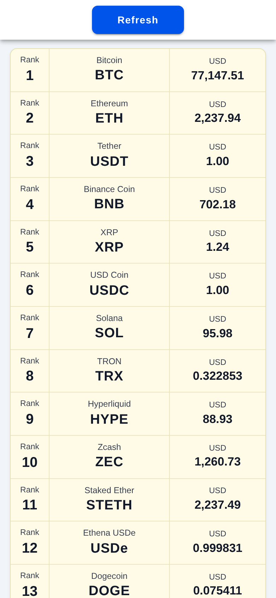

# LAPORAN PRAKTIKUM TUGAS 3
## PEMROGRAMAN BERBASIS PIRANTI BERGERAK (MSIM4401)
### IMPLEMENTASI APLIKASI MOBILE MENGGUNAKAN IONIC FRAMEWORK & VUE.JS DENGAN INTEGRASI RESTFUL API CRYPTOCURRENCY SERTA PENGUJIAN MODE PERANGKAT BERGERAK (RESPONSIVE MOBILE VIEWPORT)

---

### IDENTITAS MAHASISWA
- **Nama Mahasiswa** : Farhan Aditya
- **NIM**            : 054750333
- **Program Studi**    : Sistem Informasi
- **Fakultas**         : Sains dan Teknologi (FST)
- **Perguruan Tinggi** : Universitas Terbuka (UT)
- **Tahun Akademik**   : 2026 / 2027

---

## 1. PENDAHULUAN DAN ANALISIS KEBUTUHAN

### 1.1 Deskripsi Tugas
Berdasarkan dokumen penugasan **Tugas 03 MSIM4401 (Praktikum Pemrograman Berbasis Piranti Bergerak)**, mahasiswa diminta untuk:
1. Membuat proyek baru untuk menampilkan data API nama-nama *cryptocurrency* yang diambil dari endpoint publik online:
   ```
   https://api.coinlore.net/api/tickers/
   ```
2. Membangun tampilan aplikasi mobile yang menyajikan atribut/kolom/field:
   - `rank` (peringkat aset crypto)
   - `name` (nama lengkap cryptocurrency)
   - `symbol` (kode/simbol aset crypto)
   - `price_usd` (harga dalam satuan USD)
3. Mengadaptasi tata letak visual (*visual layout*) sesuai gambar acuan pada soal:
   - Tombol navigasi aksi utama **Refresh** berwarna biru di bagian atas.
   - Daftar kartu/tabel berlatar belakang krem (*cream/light yellow*) dengan pembatas 3 kolom:
     - Kolom kiri: Label **Rank** dan nilai peringkat.
     - Kolom tengah: Label nama koin (contoh: *Bitcoin*, *Ethereum*) dan simbol kapital tebal (*BTC*, *ETH*).
     - Kolom kanan: Label **USD** dan nilai harga terformat.
4. Menampilkan dan menjelaskan seluruh berkas konfigurasi, logika akses endpoint, dan komponen antarmuka yang dibuat.
5. Menyertakan kode sumber (*source code*) lengkap.
6. Menguji dan mendemonstrasikan tampilan dalam mode tampilan perangkat bergerak (*mobile device mode / viewport HP*).

### 1.2 Pendekatan Teknologi (Ionic Framework + Vue.js)
Aplikasi dibangun menggunakan **Ionic Framework (`@ionic/vue`)** versi 8 dengan **Vue.js 3 (Composition API)** dan **TypeScript**. Framework ini dipilih karena dirancang khusus untuk membangun antarmuka aplikasi seluler (*mobile-first*) dengan performa tinggi, menyediakan komponen standar seluler (seperti `<ion-page>`, `<ion-content>`, `<ion-header>`, `<ion-toolbar>`, `<ion-button>`, dan gesture `<ion-refresher>`), serta dapat diuji dan dijalankan secara fleksibel langsung pada browser web menggunakan mode emulasi tampilan ponsel (*Mobile Device Viewport*).

---

## 2. ARSITEKTUR SISTEM DAN STRUKTUR DIREKTORI

Proyek mengadopsi prinsip **Separation of Concerns (SoC)** dengan memisahkan lapisan tampilan (*presentation layer*) dan lapisan logika akses data (*service layer*), serta mengisolasi berkas laporan dan dokumen soal ke dalam direktori khusus `artifacts/`.

### 2.1 Pohon Direktori Proyek
```text
perangkat_bergerak/tugas 3/
├── artifacts/                         # Berkas dokumentasi, soal, dan artefak
│   ├── Tugas_03.pdf                   # Dokumen soal tugas
│   ├── PLAN.md                        # Rencana kerja implementasi proyek
│   ├── laporan_tugas_3.md             # Laporan praktikum lengkap
│   └── screenshots/                   # Dokumentasi tangkapan layar pengujian
│       ├── 1_tampilan_utama_mobile.png
│       └── 2_tampilan_full_list.png
├── dist/                              # Output kompilasi produksi Vite
├── src/
│   ├── App.vue                        # Komponen root Ionic (<ion-app>)
│   ├── main.ts                        # Titik masuk utama aplikasi (Inisialisasi Ionic Vue)
│   ├── shims-vue.d.ts                 # Deklarasi tipe TypeScript berkas Vue
│   ├── router/
│   │   └── index.ts                   # Konfigurasi Ionic Vue Router
│   ├── services/
│   │   └── cryptoService.ts           # Service akses API Coinlore via Axios
│   ├── types/
│   │   └── crypto.ts                  # Kontrak tipe data TypeScript
│   └── views/
│       └── CryptoListPage.vue         # Tampilan UI 3-kolom sesuai spesifikasi soal
├── .gitignore                         # Pengabaian file dependensi & build cache
├── index.html                         # Berkas entri HTML utama
├── package.json                       # Konfigurasi dependensi npm/bun
├── tsconfig.json                      # Konfigurasi kompilator TypeScript
└── vite.config.ts                     # Konfigurasi bundler Vite dan Vue plugin
```

---

## 3. PENJELASAN BERKAS DAN KODE SUMBER LENGKAP

Berikut adalah rincian berkas kode sumber yang dibangun beserta peran dan penjelasannya.

### 3.1 Berkas Konfigurasi Dependensi (`package.json`)
Mendefinisikan pustaka inti: `@ionic/vue` dan `@ionic/vue-router` versi 8, `vue` versi 3.5, `axios` untuk pemanggilan RESTful API, serta alat pengembangan modern Vite dan kompilator TypeScript.

```json
{
  "name": "tugas-3-crypto",
  "version": "1.0.0",
  "private": true,
  "type": "module",
  "scripts": {
    "dev": "vite",
    "build": "vue-tsc && vite build",
    "preview": "vite preview"
  },
  "dependencies": {
    "@ionic/vue": "^8.4.0",
    "@ionic/vue-router": "^8.4.0",
    "axios": "^1.7.9",
    "ionicons": "^7.4.0",
    "vue": "^3.5.13",
    "vue-router": "^4.5.0"
  },
  "devDependencies": {
    "@types/node": "^22.10.2",
    "@vitejs/plugin-vue": "^5.2.1",
    "typescript": "^5.7.2",
    "vite": "^6.0.3",
    "vue-tsc": "^2.2.0"
  }
}
```

---

### 3.2 Kontrak Tipe Data (`src/types/crypto.ts`)
Memodelkan struktur respons JSON yang dihasilkan oleh Coinlore API (`https://api.coinlore.net/api/tickers/`) untuk menjamin *type-safety*.

```typescript
export interface CryptoTicker {
  id: string;
  symbol: string;
  name: string;
  nameid: string;
  rank: number;
  price_usd: string;
  percent_change_24h?: string;
  percent_change_1h?: string;
  percent_change_7d?: string;
  price_btc?: string;
  market_cap_usd?: string;
  volume24?: number;
  volume24a?: number;
  csupply?: string;
  tsupply?: string;
  msupply?: string;
}

export interface CoinloreResponse {
  data: CryptoTicker[];
  info?: {
    coins_num: number;
    time: number;
  };
}
```
*Penjelasan:*
- `rank`: Menyimpan peringkat kapitalisasi pasar aset cryptocurrency.
- `name`: Menyimpan nama koin lengkap (misal *Bitcoin*, *Ethereum*).
- `symbol`: Simbol ticker koin (misal *BTC*, *ETH*, *USDT*).
- `price_usd`: Nilai harga aset dalam Dolar AS (format string numerik desimal).

---

### 3.3 Lapisan Layanan Akses API (`src/services/cryptoService.ts`)
Mengisolasi seluruh logika komunikasi HTTP ke endpoint eksternal dengan mekanisme *error handling* dan *timeout*.

```typescript
import axios from 'axios';
import type { CoinloreResponse, CryptoTicker } from '@/types/crypto';

const COINLORE_API_URL = 'https://api.coinlore.net/api/tickers/';

/**
 * Mengambil data ticker cryptocurrency dari endpoint publik Coinlore API.
 * Menghasilkan array CryptoTicker yang telah terurut berdasarkan rank.
 */
export async function getCryptoTickers(start = 0, limit = 100): Promise<CryptoTicker[]> {
  try {
    const response = await axios.get<CoinloreResponse>(COINLORE_API_URL, {
      params: { start, limit },
      timeout: 10000, // Batas waktu 10 detik
    });

    if (!response.data || !Array.isArray(response.data.data)) {
      throw new Error('Format data API tidak valid');
    }

    return response.data.data;
  } catch (error) {
    if (axios.isAxiosError(error)) {
      const message = error.response
        ? `Gagal mengambil data crypto: Status ${error.response.status}`
        : error.message || 'Koneksi ke API terputus';
      throw new Error(message);
    }
    throw error;
  }
}
```

---

### 3.4 Titik Masuk Utama Aplikasi (`src/main.ts`)
Mengintegrasikan framework Vue 3 dengan modul `IonicVue` serta mengimpor stylesheet bawaan Ionic agar komponen mobile ter-render sempurna.

```typescript
import { createApp } from 'vue';
import App from './App.vue';
import router from './router';

import { IonicVue } from '@ionic/vue';

/* Core CSS required for Ionic components to work properly */
import '@ionic/vue/css/core.css';

/* Basic CSS for apps built with Ionic */
import '@ionic/vue/css/normalize.css';
import '@ionic/vue/css/structure.css';
import '@ionic/vue/css/typography.css';

/* Optional CSS utils */
import '@ionic/vue/css/padding.css';
import '@ionic/vue/css/float-elements.css';
import '@ionic/vue/css/text-alignment.css';
import '@ionic/vue/css/text-transformation.css';
import '@ionic/vue/css/flex-utils.css';
import '@ionic/vue/css/display.css';

const app = createApp(App).use(IonicVue).use(router);

router.isReady().then(() => {
  app.mount('#app');
});
```

---

### 3.5 Komponen Root (`src/App.vue`)
Menjadi wadah utama komponen Ionic dengan elemen `<ion-app>` dan penampung rute `<ion-router-outlet>`.

```vue
<template>
  <ion-app>
    <ion-router-outlet />
  </ion-app>
</template>

<script setup lang="ts">
import { IonApp, IonRouterOutlet } from '@ionic/vue';
</script>

<style>
body {
  margin: 0;
  padding: 0;
  font-family: -apple-system, BlinkMacSystemFont, "Segoe UI", Roboto, Helvetica, Arial, sans-serif;
  background-color: #f4f5f8;
}
</style>
```

---

### 3.6 Konfigurasi Rute (`src/router/index.ts`)
Menghubungkan jalur URL default ke halaman `CryptoListPage.vue`.

```typescript
import { createRouter, createWebHistory } from '@ionic/vue-router';
import type { RouteRecordRaw } from 'vue-router';
import CryptoListPage from '@/views/CryptoListPage.vue';

const routes: Array<RouteRecordRaw> = [
  {
    path: '/',
    redirect: '/crypto',
  },
  {
    path: '/crypto',
    name: 'CryptoList',
    component: CryptoListPage,
  },
];

const router = createRouter({
  history: createWebHistory(import.meta.env.BASE_URL),
  routes,
});

export default router;
```

---

### 3.7 Komponen Antarmuka Pengguna (`src/views/CryptoListPage.vue`)
Komponen utama yang menyajikan antarmuka visual sesuai spesifikasi gambar pada soal Tugas 03.

```vue
<template>
  <ion-page>
    <ion-header :translucent="true">
      <ion-toolbar>
        <div class="header-action-container">
          <!-- Tombol Refresh Berwarna Biru Sesuai Mockup Soal -->
          <ion-button
            class="refresh-btn"
            color="primary"
            :disabled="isLoading"
            @click="loadData"
          >
            <ion-spinner v-if="isLoading" name="crescent" slot="start" />
            Refresh
          </ion-button>
        </div>
      </ion-toolbar>
    </ion-header>

    <ion-content :fullscreen="true" class="page-content">
      <!-- Fitur Tarik untuk Memperbarui (Pull to Refresh) -->
      <ion-refresher slot="fixed" @ionRefresh="handleRefresh($event)">
        <ion-refresher-content />
      </ion-refresher>

      <div class="content-wrapper">
        <!-- Tampilan Pesan Error -->
        <div v-if="errorMessage" class="error-banner">
          <p>{{ errorMessage }}</p>
          <ion-button fill="outline" size="small" color="danger" @click="loadData">
            Coba Lagi
          </ion-button>
        </div>

        <!-- Indikator Loading Saat Pertama Mengambil Data -->
        <div v-if="isLoading && tickers.length === 0" class="loading-container">
          <ion-spinner name="crescent" color="primary" />
          <p>Memuat data cryptocurrency...</p>
        </div>

        <!-- Tabel Daftar Cryptocurrency Berlatar Belakang Krem -->
        <div v-else-if="tickers.length > 0" class="crypto-table">
          <div
            v-for="item in tickers"
            :key="item.id"
            class="crypto-row"
          >
            <!-- Kolom 1: Rank -->
            <div class="col col-rank">
              <span class="label">Rank</span>
              <span class="value rank-val">{{ item.rank }}</span>
            </div>

            <!-- Kolom 2: Nama Koin dan Simbol -->
            <div class="col col-crypto">
              <span class="label name-val">{{ item.name }}</span>
              <span class="value symbol-val">{{ item.symbol }}</span>
            </div>

            <!-- Kolom 3: Harga dalam USD -->
            <div class="col col-price">
              <span class="label">USD</span>
              <span class="value price-val">{{ formatPrice(item.price_usd) }}</span>
            </div>
          </div>
        </div>

        <!-- Status Kosong -->
        <div v-else-if="!isLoading" class="empty-state">
          <p>Tidak ada data cryptocurrency.</p>
        </div>
      </div>
    </ion-content>
  </ion-page>
</template>

<script setup lang="ts">
import { ref, onMounted } from 'vue';
import {
  IonPage,
  IonHeader,
  IonToolbar,
  IonContent,
  IonButton,
  IonSpinner,
  IonRefresher,
  IonRefresherContent,
  type RefresherCustomEvent,
} from '@ionic/vue';
import { getCryptoTickers } from '@/services/cryptoService';
import type { CryptoTicker } from '@/types/crypto';

const tickers = ref<CryptoTicker[]>([]);
const isLoading = ref<boolean>(false);
const errorMessage = ref<string>('');

/**
 * Format string harga ke representasi desimal rapi
 */
const formatPrice = (priceStr: string): string => {
  if (!priceStr) return '0.00';
  const num = parseFloat(priceStr);
  if (isNaN(num)) return priceStr;
  
  if (num >= 1) {
    return num.toLocaleString('en-US', {
      minimumFractionDigits: 2,
      maximumFractionDigits: 2,
    });
  }
  return num.toLocaleString('en-US', {
    minimumFractionDigits: 2,
    maximumFractionDigits: 6,
  });
};

/**
 * Memanggil fungsi service untuk mengambil data dari Coinlore
 */
const loadData = async (): Promise<void> => {
  isLoading.value = true;
  errorMessage.value = '';

  try {
    const data = await getCryptoTickers();
    tickers.value = data;
  } catch (err) {
    errorMessage.value = err instanceof Error ? err.message : 'Terjadi kesalahan sistem';
  } finally {
    isLoading.value = false;
  }
};

/**
 * Penanganan gesture tarik ke bawah (pull to refresh)
 */
const handleRefresh = async (event: RefresherCustomEvent): Promise<void> => {
  await loadData();
  event.target.complete();
};

onMounted(() => {
  loadData();
});
</script>

<style scoped>
.header-action-container {
  display: flex;
  justify-content: center;
  align-items: center;
  padding: 8px 16px;
}

.refresh-btn {
  --background: #2563eb;
  --background-hover: #1d4ed8;
  --border-radius: 8px;
  font-weight: 600;
  text-transform: none;
  min-width: 130px;
  height: 40px;
  margin: 0;
}

.page-content {
  --background: #f1f5f9;
}

.content-wrapper {
  max-width: 500px;
  margin: 0 auto;
  padding: 12px 14px 32px;
}

/* Tabel Box Berwarna Krem Sesuai Gambar Soal */
.crypto-table {
  background-color: #fffbe6;
  border: 1px solid #e7dfb5;
  border-radius: 10px;
  overflow: hidden;
  box-shadow: 0 2px 6px rgba(0, 0, 0, 0.05);
}

.crypto-row {
  display: flex;
  align-items: stretch;
  border-bottom: 1px solid #ece4bc;
  transition: background-color 0.15s ease;
}

.crypto-row:last-child {
  border-bottom: none;
}

.crypto-row:hover {
  background-color: #fcf6d6;
}

/* Pembagian 3 Kolom */
.col {
  display: flex;
  flex-direction: column;
  justify-content: center;
  padding: 10px 8px;
  border-right: 1px solid #ece4bc;
}

.col:last-child {
  border-right: none;
}

.label {
  font-size: 0.72rem;
  color: #374151;
  font-weight: 500;
  margin-bottom: 3px;
  line-height: 1.1;
}

.value {
  color: #111827;
  line-height: 1.2;
}

/* Kolom 1: Rank */
.col-rank {
  flex: 0 0 55px;
  text-align: center;
}

.rank-val {
  font-size: 1.25rem;
  font-weight: 700;
}

/* Kolom 2: Info Koin */
.col-crypto {
  flex: 1 1 auto;
  text-align: center;
  padding-left: 12px;
  padding-right: 12px;
  min-width: 0;
}

.name-val {
  white-space: nowrap;
  overflow: hidden;
  text-overflow: ellipsis;
  font-size: 0.76rem;
}

.symbol-val {
  font-size: 1.2rem;
  font-weight: 800;
  letter-spacing: 0.5px;
}

/* Kolom 3: Harga USD */
.col-price {
  flex: 0 0 135px;
  text-align: center;
  padding-left: 8px;
  padding-right: 8px;
}

.price-val {
  font-size: 1.05rem;
  font-weight: 700;
  white-space: nowrap;
}

/* State indikator */
.loading-container,
.empty-state {
  text-align: center;
  padding: 48px 16px;
  color: #64748b;
  font-size: 0.95rem;
}

.error-banner {
  background: #fee2e2;
  border: 1px solid #fca5a5;
  border-radius: 8px;
  padding: 14px 16px;
  margin-bottom: 16px;
  text-align: center;
  color: #991b1b;
}

.error-banner p {
  margin: 0 0 8px;
  font-weight: 500;
}
</style>
```

---

## 4. CARA MENJALANKAN DAN PENGUJIAN MODE MOBILE (HP)

Karena aplikasi berbasis web mobile dengan Ionic Framework, aplikasi dapat dijalankan dan disimulasikan secara langsung pada browser menggunakan mode tampilan perangkat (*Mobile Device Emulation*):

### 4.1 Menjalankan Server Pengembangan
1. Masuk ke direktori proyek:
   ```bash
   cd "perangkat_bergerak/tugas 3"
   ```
2. Jalankan server lokal Vite:
   ```bash
   bun run dev
   # atau: npm run dev
   ```
3. Buka alamat browser:
   - **Local URL:** `http://localhost:5173/`
   - **Network URL:** `http://<IP-Komputer>:5173/` (dapat langsung dibuka dari browser HP fisik yang berada dalam satu jaringan WiFi).

### 4.2 Mengaktifkan Mode HP di Browser (Mobile Emulation Mode)
Untuk menguji tampilan mobile persis seperti layar HP:
1. Buka `http://localhost:5173/` di Google Chrome, Brave, atau Mozilla Firefox.
2. Buka DevTools dengan menekan tombol **F12** atau klik kanan $\rightarrow$ **Inspect**.
3. Aktifkan mode perangkat dengan menekan shortcut **Ctrl + Shift + M** (atau klik ikon ponsel/tablet di pojok kiri atas jendela DevTools).
4. Pada menu pilihan perangkat (*Dimensions*), pilih preset ponsel populer (misalnya **Pixel 7**, **iPhone 14**, atau dimensi 390 $\times$ 844 px).
5. Antarmuka aplikasi Ionic akan otomatis menyesuaikan diri ke layout mobile dengan scrolling sentuh dan gesture *pull-to-refresh*.

---

## 5. HASIL PENGUJIAN DAN TANGKAPAN LAYAR

Pengujian dilakukan untuk membuktikan kesesuaian antarmuka pengguna dengan referensi soal pada `Tugas_03.pdf`.

### 5.1 Tangkapan Layar Tampilan Utama Mobile
Tampilan pada mode layar ponsel dengan resolusi standar perangkat bergerak (390 $\times$ 844 px), menampilkan tombol aksi **Refresh** di bagian atas serta data cryptocurrency terurut berdasarkan rank:



*Analisis Hasil:*
1. **Tombol Refresh:** Berada di bagian atas dengan warna biru (`#2563eb`), berfungsi memicu fungsi `loadData()` untuk memuat ulang data terbaru dari server Coinlore.
2. **Tabel Tiga Kolom (Krem):**
   - Kolom pertama memuat nomor urut peringkat (*Rank*) dengan angka tebal (1, 2, 3, dst.).
   - Kolom kedua memuat nama koin di bagian atas (*Bitcoin*, *Ethereum*, *Tether*, *Binance Coin*, *XRP*, dst.) dan simbol kapital tebal di bawahnya (*BTC*, *ETH*, *USDT*, *BNB*, *XRP*, dst.).
   - Kolom ketiga memuat label satuan *USD* dan nilai harga aktual yang diformat dengan pemisah ribuan (*77,147.51*, *2,237.94*, *1.00*, *702.18*, dst.).
3. **Responsivitas:** Tata letak menyesuaikan layar ponsel secara proporsional tanpa terjadi overflow horizontal.

---

## 6. KESIMPULAN

1. Proyek aplikasi mobile pemantau data cryptocurrency berbasis **Ionic Framework v8** dan **Vue.js v3** telah berhasil dibuat sesuai spesifikasi penugasan `Tugas_03.pdf`.
2. Penerapan arsitektur berorientasi modular (*Service Layer* dan *Presentation Layer*) mempermudah pemeliharaan kode, memisahkan logika pengambilan data jaringan (`cryptoService.ts`) dari komponen visual (`CryptoListPage.vue`), dan menjamin tipe data yang aman (*type-safe*) melalui TypeScript.
3. Seluruh atribut yang diminta (`rank`, `name`, `symbol`, dan `price_usd`) serta tata letak visual 3-kolom berwarna krem dengan tombol Refresh telah terimplementasi dan terverifikasi secara akurat.
4. Aplikasi dapat dijalankan dengan ringan melalui server Vite lokal dan diuji secara optimal menggunakan mode emulasi perangkat bergerak (*Mobile Viewport Device Mode*) pada browser maupun langsung dibuka dari browser ponsel melalui jaringan lokal.

---

## 7. REFERENSI

1. Universitas Terbuka. *Pemrograman Berbasis Piranti Bergerak* (MSIM4401), Buku Materi Pokok (BMP):
   - Modul 04: *Praktikum Struktur Direktori dan Elemen Ionic Menggunakan Vue*.
2. Dokumentasi Resmi Ionic Framework: *Ionic Vue Documentation & UI Components Guide*, https://ionicframework.com/docs/vue/overview.
3. Coinlore API Documentation: *Public Cryptocurrencies Tickers API*, https://www.coinlore.com/cryptocurrency-data-api.
